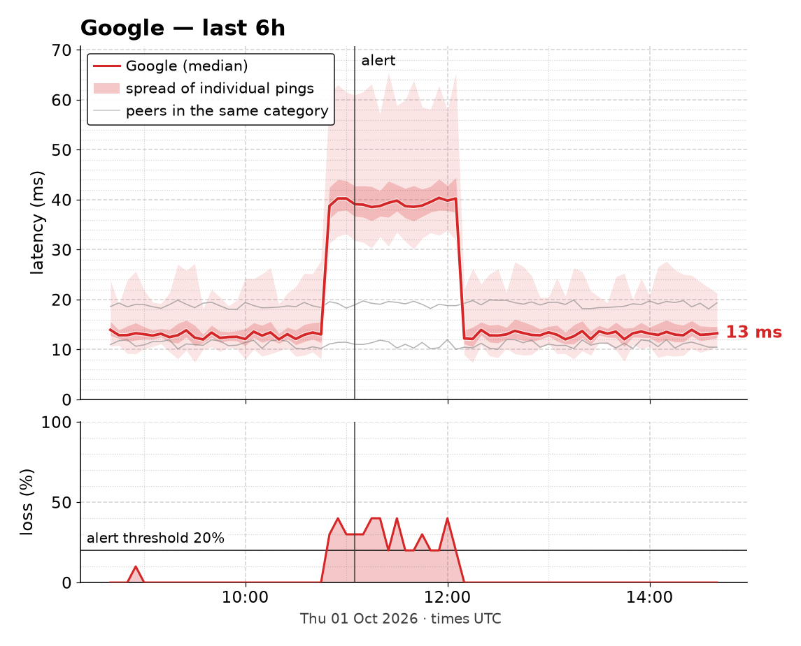
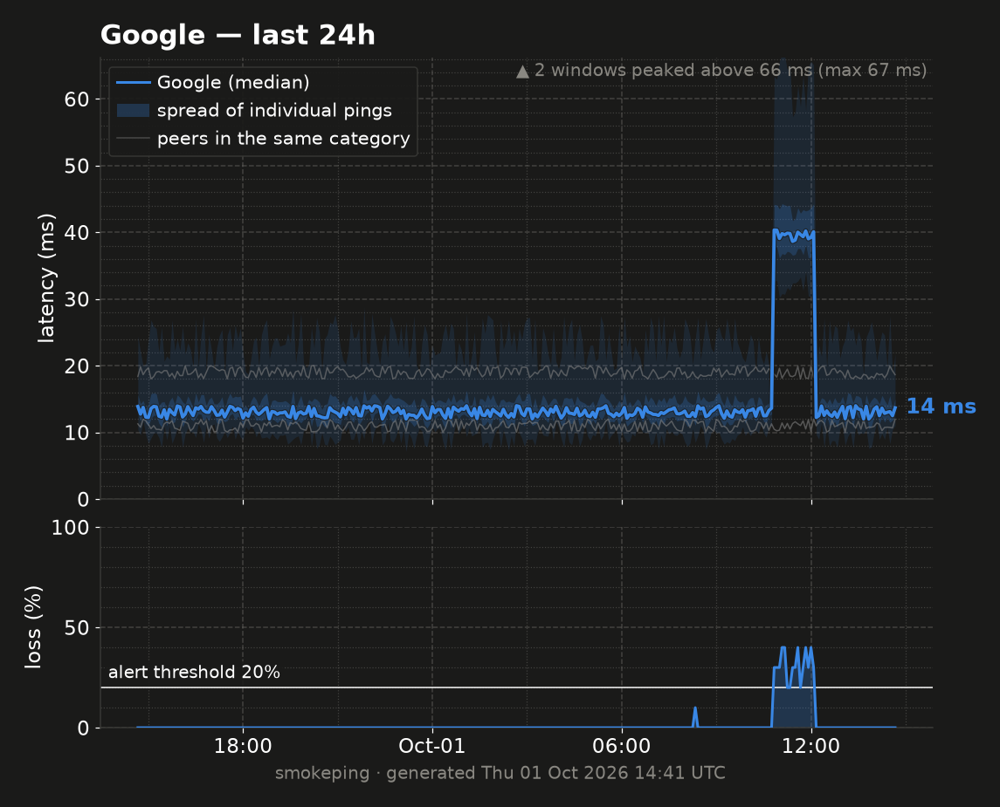
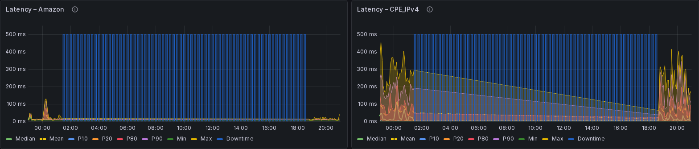
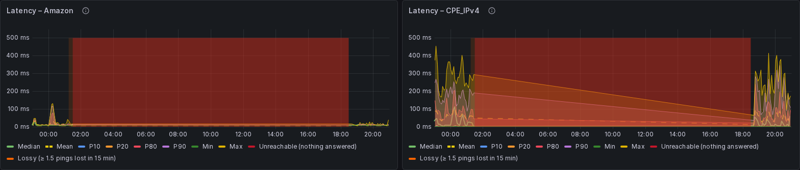
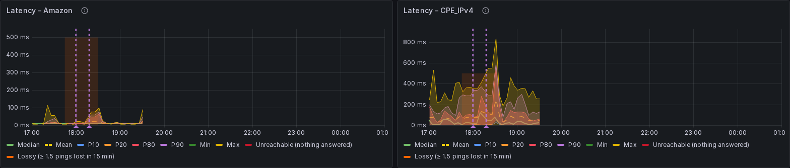

# Alerting Engine (`alerter`)

Deterministic alerting for the Pro edition: a small Python service that
evaluates rules against InfluxDB every minute and delivers notifications via
an [OpenClaw](https://openclaw.ai) hook or a generic webhook. No LLM
involved — the rules are plain thresholds, so behavior is predictable and
testable.

Module: `shared/modules/alerter/`. Opt-in via the `alerts` Compose profile:

```bash
sudo smoking-pi alerts --telegram --test   # or --openclaw, --webhook (below)
```

which turns on the profile, recreates the alerter and prints its own
delivery check. `sudo smoking-pi enable alerts` turns it on alone (it logs
alerts and sends nothing until `NOTIFY_MODE` points somewhere).

The service runs with `network_mode: host`, so it reaches InfluxDB on
`localhost:8086` and a locally running OpenClaw gateway on
`127.0.0.1:18789` without extra wiring.

## Rules

| Rule | Severity | Condition | Tunables (default) |
|------|----------|-----------|--------------------|
| `uplink_down` | critical | Most targets (`WIDESPREAD_PCT` of those reporting) at 100% loss in each of the latest 3 probe cycles, consecutive in time (one absent cycle tolerated), and the first hop (the ISP gateway, category `cpe`) lost too — the monitor's own uplink is gone. With no first-hop measurement it says the two cannot be told apart. The first hop never counts in the breadth: it is evidence, not a destination. ONE incident; the per-target ones it would fan out into are not sent | `WIDESPREAD_PCT` (80 %), `DOWN_WINDOW` |
| `internet_down` | critical | The same total loss while the first hop **answers**: the Internet beyond the house is down, not this host or the line. Before, this read "this host's uplink is down". Verdict `isp_upstream` | as `uplink_down` |
| `monitor_dns` | critical | Every named destination at 100% for the same 3 cycles while the first hop and the DNS resolvers queried by address (`dns_latency`) answer: this host cannot resolve names (its own DNS; 2026-08: a frozen `resolv.conf`), the network is fine. Verdict `monitoring` | as `uplink_down` |
| `outage` | warning | A run of probe cycles in which most targets lost at least `WIDESPREAD_LOSS_PCT` at once — a brief cut of the link that had ended by the time it was seen. ONE incident per run, keyed by its first cycle — and by the first cycle of the outage it continues once that has slid out of the window, so a long one is still one incident; *transient*: it leaves the window on its own and no recovery notice follows. The tail of an `uplink_down` (lost cycles still in the window after the uplink returned) is not an outage: it suppresses the per-target incidents and is never sent | `WIDESPREAD_PCT` (80 %), `WIDESPREAD_LOSS_PCT` (30 %) |
| `target_down` | critical | ALL loss points for a target (`latency` + `dns_latency`) in the last window are >= 99.9% loss, with at least 3 points. Not sent while anything widespread is active | `DOWN_WINDOW` (1200 s) |
| `high_loss` | warning | Mean loss for a target over 15 min exceeds the threshold **and** the loss persisted: at least `HIGH_LOSS_MIN_POINTS` probe cycles that lost two or more pings (see [Probe cadence](#probe-cadence)) within the same 15 minutes the mean covers. Targets already down are excluded; not sent while anything widespread is active | `HIGH_LOSS_PCT` (20 %), `HIGH_LOSS_MIN_POINTS` (2) |
| `microcut_burst` | warning | Per target+protocol in `cpe_latency`, over the last 60 min: a **confirmed cut** — a run of two or more consecutive 10 s windows above `MICROCUT_LOSS_PCT`, or one window at 100% — or `MICROCUT_BURST_N` **possible cuts** (isolated single windows at 51–99%). The message names the cut and its duration (*"1 cut of 2 min 40 s (6 windows, all at 100%)"*). Definitions in `common/microcuts.py`, shared with the MCP tool, the weekly summary and the AI report | `MICROCUT_BURST_N` (3), `MICROCUT_LOSS_PCT` (50 %) |
| `exporter_stale` | critical | Zero `latency` points written in the last window (global — the RRD exporter is probably stalled). Not while the bucket holds no latency point at all: a new install has none before its first step, and has not stalled. An incident already open stays open | `STALE_WINDOW` (1200 s) |
| `measurement_stale` | warning | One of the other writers stopped: no `dns_latency`, `http_latency`, `tcp_latency`, `cpe_latency` (gateway microcut probe) or `wifi_link` point in the window (or in four of that measurement's own steps, when longer), though it wrote within the last 24 hours. A host that never had one (wired: no `wifi_link`) is not expected to. Not while `exporter_stale` is open: that is one stall, one message. A writer silent for more than 24 hours is taken as removed on purpose (an Ethernet uplink, a disabled probe) and the incident is retired without a recovery; mute it to stop it sooner. Without it, a stopped microcut probe or Wi-Fi exporter silently took the evidence the verdict and diagnosis read | `STALE_WINDOW` (1200 s) |
| `influx_unreadable` | critical | The alerter could not read InfluxDB for five minutes: no rule ran, so the absence of alerts means nothing. Every other open incident is held as it was (neither recovered nor re-sent, its grace period restarted) until the database answers again; it counts as readable after three good cycles in a row, so a database failing every other cycle still alerts. For one stale window after that, a new `exporter_stale` or `measurement_stale` is not raised: the writers could not write meanwhile. The weekly summary, the AI reports and the incident history are skipped while blind (each reads InfluxDB). Before, each failed cycle only went to the log | — |
| `evaluation_failed` | critical | The same blindness from a bug in the alerter's own rules rather than the database (any exception that is not a connection or InfluxDB client error): no rule ran. Held and counted as `influx_unreadable` is; the traceback is in the alerter's log | — |
| `watchdog` | info / warning | What `smoking-pi watchdog` did on the host, read from `watchdog_event` in InfluxDB: a driver reload, a reboot, a SmokePing restart, the network back (info); an action it could not take or a SmokePing crash loop (warning). Each event once, never a recovery; the first look after an upgrade skips older ones. See [watchdog.md](watchdog.md) | — |
| `ipv6_down` | warning | Every IPv6 target (name ends in `6`, or an `fping6`-ish category) at 100% loss for 15 min while at least one IPv4 target is healthy; emits ONE aggregate incident | — |

Loss semantics match the exporters: `latency`/`dns_latency` loss is a 0-1
ratio (legacy packet counts 0..20 are clamped), `cpe_latency` loss is a
percent 0-100.

**Why the widespread rules exist.** On the reference Pi the Wi-Fi radio hung
twice in September 2026 — associated to the access point at −49 dBm, uplink
flag set, and not one packet received for 3 h 20 min (and, earlier, 21 h).
Every target went to 100% including the LAN gateway, and the alerter sent 18
`target_down` criticals plus 18 `high_loss` warnings, re-sent at every
cooldown: about 110 messages for one fact. A 3-minute blink on 2026-09-19 did
the same in miniature — every target got one bad cycle, every 15-minute mean
cleared 20%, and 18 warnings plus 18 recoveries went out for a link that
blinked. Both shapes are now one incident, and its verdict line says what it
is (see `monitor_uplink` below). The evidence and the numbers behind the
thresholds are in [detection-reliability.md](detection-reliability.md).

**Which targets count in the breadth.** Every ICMP and DNS resolver target
counts and can also alert on its own. The HTTP and TCP probes and the DNS
wizard's adopted services (every protocol) count in the breadth only: they
never raise a `target_down` or `high_loss`, but they are in the share that
makes `outage`, `uplink_down`, `internet_down` and `monitor_dns`, and in
the verdict's count. Before, the breadth was the ICMP and resolver targets
alone, 19 of 247 on the reference Pi, so a handful of sites losing packets
read as "the link". A breadth-only target counts in a window only when at
least half of its points in that window were clean (under one and a half
lost pings): a CDN that drops ICMP sits at 100% forever, and a path that
blocks HTTP/3 half the time is lossy all day; either would otherwise be in
every cycle's share. One on a slower step than the rules' bucket does not
count: it would report in one cycle of two. `monitor_dns` needs
`WIDESPREAD_PCT` of the named targets lost, not every one.

The diagnosis attached to an alert, the incident history, and the MCP
`diagnose_loss` and `get_loss_events` count breadth-only targets by the
same rule (`common/breadth.py`), so an alert's "14 of 16" and its
diagnosis's agree. One difference: the alerter takes the vote over its own
window (20 minutes), they take it over theirs (hours to a week). A target
lossy for most of the week does not vote in a week's diagnosis, even in a
cycle where the alerter counted it; at the moment an alert fires, the two
sets are the same unless a target was lossy for most of the diagnosis
window. Over those windows only queries InfluxDB answers from its storage
engine are asked -- points per target, points at or above the event bar,
each target's first and last point, and per cycle how many voters were
lossy and how many lost everything -- and the cycles are put together in
Python. On the reference Pi (224 breadth-only targets) that is about 3 s
for a day and 16 s for a week; every query answers one row per target or
per cycle, however long an outage. A target reports in every cycle from its
first point to its last, so a gap of a few cycles counts as reporting. The
breadth is counted over a week at most: a longer `get_loss_events` counts
the ICMP and resolver targets alone. `breadth_only: false` (in
`diagnose_loss`'s `coverage`) means the breadth was not counted for any
reason: a longer window, a failed query, or no target voting. The alerter's
and the MCP server's logs say which. The few breadth-only targets that lose
a point in any cycle count only once a cycle is broad: beside one named
site's miss they are background. Breadth-only targets are counts there and
nothing else: an incident's `targets`, the one-or-two-sites `destination`
class and every per-target list are the ICMP and resolver targets. A cut of
the web services alone, every ping answering, is an incident with no
`targets`.

## Incident lifecycle

State lives in a JSON file (`ALERT_STATE_FILE`, default
`/var/lib/alerter/state.json` on the `alerter-state` volume; falls back to
`/tmp/alerter-state.json` if unwritable). Writes are atomic.

- **First seen** → notification fires immediately.
- **Still active** → silent until `ALERT_COOLDOWN` (default 3600 s) has
  elapsed since the last notification, then re-notifies.
- **Cleared** → a single recovery notice (only if the incident ever fired).
  A *transient* incident (`outage`) is dropped silently instead: it
  describes a cut that had already ended when it was reported, and
  "recovered — was down 20 min" would be false twice over.
- **"Was down N min"** runs from the first alert to the first cycle the
  rule no longer fired. The `ALERT_RESOLVE_AFTER` wait before the notice is
  not counted. It is said only by the rules where nothing answered
  (`target_down`, `uplink_down`, `internet_down`, `monitor_dns`,
  `ipv6_down`, `exporter_stale`): they need
  every cycle in their window lost, so they clear on the first good one.
  They also fire only after their window has filled, so the figure can
  undercount by that window (20 minutes for `target_down`); it never
  overcounts.
- `microcut_burst` and `high_loss` recoveries give no duration. They keep
  firing while the event is inside their window (any cut in 60 minutes; a
  15-minute mean), so the alert's open time would make a 2-minute cut read
  as an hour. Their message already says what was measured.

- **No data is not a recovery.** An incident about a target that no longer
  has enough points to judge (three in the down window) is *held*: neither
  missing nor recovered, whatever the reason — a stalled probe, the
  exporter itself (`exporter_stale`), a renamed or removed target. Its
  recovery comes once data shows it answering. `uplink_down`,
  `internet_down`, `monitor_dns` and `outage` are held when no target has
  data at all. The three total-loss incidents are one at a time: when the
  reading changes mid-outage (the gateway reboots, or comes back before
  the ISP does), the new one supersedes the old without a "recovered", and
  is sent as news. After 24 hours with no data the
  incident is dropped without a notice. `list_alert_state` shows a held
  incident's `no_data_since`.
- **Worse replaces milder.** A target that goes down usually crossed
  `high_loss` two cycles earlier. `target_down` *supersedes* that warning:
  it is retired without a recovery, and `high_loss` stays off for the
  target until the `target_down` record is gone. One problem reads warning,
  critical, recovered.

Per incident the state tracks `first_seen`, `last_seen`, `last_notified`,
`notified_count`, and while it applies `missing_since` or `held_since`.

## Notifier modes (`NOTIFY_MODE`)

**The short way** (Pro), straight to Telegram with a bot of your own:

```bash
sudo smoking-pi alerts --telegram
```

It explains how to make the bot (in Telegram, `@BotFather`, then `/newbot`)
and asks for the bot's token, hidden as you type. Then it asks you to send
the bot any message and reads your chat id from it, so there is nothing to
look up. It counts only a message sent after it asked, shows whose message
it was, and asks before using that chat.

**A bot that OpenClaw (or anything else) already uses:** give the chat
yourself, with `--to CHAT_ID`. If OpenClaw is set up, `OPENCLAW_TO` is
`telegram:CHAT_ID`. Finding the chat reads the bot's incoming messages,
which Telegram allows one program at a time and marks as read, so the
other program could lose a message. If the bot has a webhook set, finding
the chat fails outright. The command asks about this before reading. Sending alerts through a shared bot is
fine. Alerts sent this way do not enter OpenClaw's conversation, though,
so the assistant does not know about them. A bot only for alerts keeps them
apart. The steps after that are the same as for OpenClaw below: the
`alerts` profile, the alerter's preflight, and an optional `--test`. No
OpenClaw needed. With OpenClaw on the Pi instead:

```bash
sudo smoking-pi alerts --openclaw --to telegram:<your chat id>
```

This sets `NOTIFY_MODE` and the keys below. It takes the gateway token from
your `~/.openclaw/openclaw.json` when there is one, turns on the `alerts`
profile, recreates the alerter, and prints the alerter's own delivery
preflight: reachable, a rejected token, or the `message` tool filtered out
by policy. Add `--test` to send one labeled message. The preflight shows the
gateway would accept a send, not that the recipient is right; a message
arriving is the only proof. `--webhook` (the URL typed at a prompt or piped on stdin: it is often
the credential itself) and `--off` work the same way.
Run it with no options to be asked.

Messages carry a severity headline (🔴 critical, 🟡 warning, ✅ recovery), the
verdict line, the numbers, a breadth recap, deep links, and a mute hint —
composed to fit the channel's budget. See [The verdict](#the-verdict-is-it-me-or-the-internet)
and [Message rendering](#message-rendering) below.

### `off` (default)

Log-only. Rules are still evaluated and incidents logged, so you can watch
`docker compose logs alerter` before wiring up delivery.

### `telegram`

Sends straight to the Telegram Bot API with your own bot, no gateway in
between: `sendMessage`, or `sendPhoto` with the message as the caption when
there is a chart (`sendDocument` with `ALERT_IMAGE_AS_DOCUMENT=true`). The
text is the same Telegram HTML the OpenClaw path sends. Link previews are
off, because the links point at this house's Grafana. The weekly summary
is sent silently.

```env
NOTIFY_MODE=telegram
TELEGRAM_BOT_TOKEN=<from @BotFather>
TELEGRAM_CHAT_ID=<your chat id; -100... for a group>
```

- **The token is part of every Bot API URL** (`/bot<token>/sendMessage`),
  so the alerter never logs a URL or an exception's text. A failure is
  logged as the method, the HTTP status and Telegram's own description.
  httpx's own request log, which names every URL, is turned down to
  warnings, and a filter on it replaces the token with `<redacted>` in case
  that log is turned up again.
- **A bot can write only to someone who wrote to it first.** The preflight
  checks both halves at start: `getMe` (is the token a bot's?) and
  `getChat` (can it reach the chat?). The usual failure is
  `chat not found` because nobody has messaged the bot yet.
- A 4xx is the request's fault (a wrong chat, a blocked bot) and is not
  retried. A 429 waits as long as Telegram asks, up to 30 s, and a 5xx or no
  answer is retried three times. A retry after no answer can deliver the
  same alert twice, because Telegram may have sent the first one. As with
  OpenClaw, a chart that fails to send never costs the alert: it is retried
  as text. If Telegram cannot parse the message's HTML, the same words are
  sent once more without markup.
- `sudo smoking-pi config set TELEGRAM_BOT_TOKEN` replaces the token, read
  from a prompt or stdin, never the command line.

### `openclaw`

Invokes OpenClaw's `message` tool over the Gateway's HTTP endpoint,
`POST {OPENCLAW_URL}/tools/invoke`, with
`Authorization: Bearer {OPENCLAW_GATEWAY_TOKEN}` and body:

```json
{
  "name": "message",
  "args": {
    "action": "send",
    "channel": "telegram",
    "to": "telegram:123456789",
    "message": "🔴 <b>critical</b> — <target>\n🌐 Not you — 12 of 16 ..."
  }
}
```

`/tools/invoke` is always enabled on a stock gateway and is multiplexed onto
the same port as the WebSocket protocol. It is gated by Gateway auth plus
tool policy — so the `message` tool must also be permitted by
`tools.allow` in `openclaw.json`.

Example `.env` values:

```bash
NOTIFY_MODE=openclaw
OPENCLAW_URL=http://127.0.0.1:18789
OPENCLAW_GATEWAY_TOKEN=<gateway.auth.token from ~/.openclaw/openclaw.json>
OPENCLAW_CHANNEL=telegram
OPENCLAW_TO=telegram:<your-chat-id>
```

Find your recipient with `openclaw gateway call sessions-list` and read
`deliveryContext.to`.

The alerter runs with `network_mode: host`, so the loopback default reaches
the gateway with no extra plumbing.

> **Earlier versions of this document said a stock gateway serves no HTTP at
> all.** That was wrong. It came from probing `/hooks/agent` — a path that
> exists on no OpenClaw build — getting a 404, and generalising from one
> missing route to the whole surface. `/tools/invoke`, `/v1/*` and the other
> documented HTTP APIs were there the entire time.

Two failure modes are specific to this endpoint, and the alerter checks for
both at startup:

- It answers **HTTP 200 with `{"ok": false}`** when the tool itself fails.
  Trusting the status code alone would count a refused send as a delivered
  alert, so the body is inspected. A failure is **not sent again**, by any
  path: once the gateway has the request it holds the message in its own
  durable delivery queue and replays it when it can, and each new attempt
  was one more copy (2026-10-09: six of one alert in one second). The same
  goes for a request it received and did not answer within the 10 s
  timeout, and for an HTTP 500. Only a request that never reached it (the
  connection refused, a request not written whole, or a proxy in front of a
  remote gateway answering 502, 503 or 504) waits in the outbox for another
  try; only one it
  refused outright (HTTP 4xx) gets the text-only retry a refused chart
  gets.
- It answers `Tool not available: message` when tool policy filters the tool
  out, rather than when it is missing. The preflight distinguishes that from
  a bad token (401) and an unreachable gateway.

A healthy preflight logs:

```
INFO alerter.notifier: Delivery preflight: http://127.0.0.1:18789/tools/invoke
reachable, 'message' tool permitted (HTTP 200)
```

Use `telegram` mode above, or `webhook` below, if you want something with no OpenClaw version
dependency. Full recipe, including MCP registration:
[docs/openclaw-integration.md](openclaw-integration.md).

### `webhook`

POSTs JSON to `ALERT_WEBHOOK_URL`, optionally with
`Authorization: Bearer {ALERT_WEBHOOK_TOKEN}`:

```json
{
  "type": "alert",
  "rule": "high_loss",
  "severity": "warning",
  "target": "<target>",
  "message": "🟡 <b>warning</b> — <target>\n🎯 Just that site — 1 of 16 ...",
  "state": {"first_seen": 0, "last_seen": 0, "last_notified": 0, "notified_count": 1},
  "ts": "2026-01-01T00:00:00+00:00"
}
```

`type` is `alert`, `recovery`, `report`, `weekly`, `held`, or `undelivered` (see
below).

Delivery (both HTTP modes): 10 s timeout. The webhook gets 3 attempts with
exponential backoff; the OpenClaw gateway gets one request per message, and
the outbox tries again next cycle when that request never reached it.
Failures are logged, never crash the loop.

### When delivery fails: the outbox

An alert or recovery that cannot be delivered is kept in the state file's
outbox, not dropped. While anything waits there:

- new alerts and recoveries join it instead of being sent into a dead link
  (no chart: a summary has none);
- once a minute at first, doubling to every 10 minutes, the alerter checks
  whether delivery could leave the house (a TCP connect to
  `api.telegram.org:443` for Telegram, the webhook's host, or `1.1.1.1:443`
  for another OpenClaw channel) and tries only then;
- what it delivers is **one message**: a single notification younger than
  10 minutes as it was, otherwise a summary, type `undelivered`, of the
  whole stretch: what is open now, then each incident once, when it
  started, whether it recovered (`(over)` when it ended without one, as a
  brief `outage` does);
- if the receiver refuses the summary three times while the network is up
  (a revoked token, or text it rejects), a plain fallback with only counts
  and rule names goes instead, so a summary that cannot be sent never holds
  later alerts behind it for good.

The outbox holds at most 100 notifications (the oldest go first, and the
summary counts them). `list_alert_state` shows what is waiting
(`undelivered`), and each notification's payload carries its
`delivery`: `sent`, `queued` (in the outbox), `handed` (to the OpenClaw
gateway) or `held`.

Before, a failed alert waited for the next hourly cooldown, a failed
`outage` was never retried, and a failed recovery was lost. During the
reference Pi's 11-hour radio hang on 2026-10-11 every alert failed, and
nothing afterwards said what had happened.

One limit remains: the state file is written once per cycle, after the
sends. A crash between a send and that write sends it again on restart.

### Said once: what delivery guarantees

Every alert, re-notification and recovery has an idempotency key: the
incident (its key and when it was first seen) and the kind of message (the
first alert, the n-th hourly re-notification, the recovery). The state file
records, for seven days, what became of each: `sent`; `queued`, when the
OpenClaw gateway answered or may have received it, and delivers it from its
own queue; `told`, by an outbox or quiet-hours summary; `held`; or waiting
in the outbox. A key that was sent, queued or told is never handed to a
transport again, whether a direct send, an outbox resend or the end of
quiet hours tries it. A summary that is delivered marks everything it
carries as told, and drops what still waits elsewhere about the same
incident and kind: an outbox summary during quiet hours takes the held
re-notification of the same alert with it. A recovery is its own kind: an
incident told only in a summary still recovers, once.

A message the gateway answered with a failure keeps the outbox shut until
the next check finds delivery reachable, so what follows meanwhile waits
there and arrives as one summary; it is neither resent nor listed in that
summary: the gateway delivers it. The daily report counts the same way. If the gateway drops a
message it answered with a failure, the alerter does not know; the next
summary's "Now open" line still shows the incident while it is open.

Before (2026-10-18 and 10-28), an outage alert that opened the outbox had
two copies in the gateway (the attempt that timed out, and the retry it
answered with `ok: false`): the outbox summary told the outage, and 4 to 5
minutes later the gateway replayed both copies, identical, one minute
apart. A send the gateway delivered but answered with a failure was also
sent again by the outbox a minute later, as it was.

### Times in messages

Every time the alerter prints is in one zone: `DIGEST_TZ`, which
`smoking-pi alerts --digest-tz America/Chicago` sets, falling back to `TZ`
and then UTC exactly as the weekly summary's schedule and quiet hours do.
That covers alerts and recoveries, the "not delivered" summary, the
quiet-hours message, the watchdog's actions and the weekly summary. A time
today reads `20:40`; any other day carries its date, `28 Oct 20:40` (the
weekly summary adds the weekday: `Wed 28 Oct 20:40`). When `DIGEST_TZ` is
unset or not a zone, the zone in use is named after the time (`01:40 UTC`),
since nobody chose it; an unknown name is logged once. No time is read from
the process's local zone, and what is stored (the state file, InfluxDB)
stays in UTC.

```bash
sudo smoking-pi alerts --digest-tz America/Chicago
```

### Quiet hours

Between `QUIET_FROM` and `QUIET_UNTIL`, per-target alerts, brief outages,
microcuts, recoveries and the watchdog's actions are held instead of sent.
When quiet hours end, everything held goes out as **one message**, type
`held`, without a notification sound: what is open now, then each
incident once, when it started and whether it recovered. It is the
outbox's summary, with times in `DIGEST_TZ` like every other message
(see [Times in messages](#times-in-messages)).

Never held, because they are worth waking up for or because without them
a quiet night proves nothing:
- a total loss: `uplink_down`, `internet_down`, `monitor_dns`;
- the monitor going blind or deaf: `influx_unreadable`,
  `evaluation_failed`, `exporter_stale`, `measurement_stale`.

A `target_down` is held. The outbox is not held either: a notification
already late because delivery failed goes as soon as it can. When the
summary itself cannot be delivered, the outbox keeps it, and an outbox
summary lists the held incidents, not the summary.

```bash
sudo smoking-pi alerts --quiet 23:00-07:00
sudo smoking-pi alerts --quiet off
```

The times are in `DIGEST_TZ` (then `TZ`, then UTC), the zone of every message, and
a span may cross midnight. Both are checked before anything is written.
Quiet hours are off while either value is empty or unreadable; the alerter
logs a warning and sends everything as it happens. Turning them off sends
what was held on the next cycle. A held notification's `delivery` is
`held`, and MCP `list_alert_state` shows
what is waiting (`held`: how many, since when, until when, which
incidents), so an assistant asked at 4 a.m. does not answer "all quiet".
A crash between sending the summary and saving the state sends it again
on restart, the same limit as the outbox's.

| Variable | Default | Meaning |
|---|---|---|
| `QUIET_FROM` | *(unset)* | `HH:MM` when quiet hours begin |
| `QUIET_UNTIL` | *(unset)* | `HH:MM` when they end and the held message goes out |

### When this host goes silent: the dead man's switch

Every alert comes from the host being watched. When it hangs, loses power
or its SD card, the alerts stop, and silence reads as "all well". A
check-in service closes that gap from outside: the alerter checks in with
it, and the service alerts you when the check-ins stop. Because it runs off
this host, it is the one alert that still works when the whole house is
down.

1. On [healthchecks.io](https://healthchecks.io) (free; or a self-hosted
   Healthchecks), add a check with a period of 5 minutes and a grace of 10,
   and connect it to where you want the alert (email, Telegram).
2. Give the alerter its ping URL, which is read hidden (or from stdin)
   because it is a credential:

   ```bash
   sudo smoking-pi alerts --deadman
   ```

   The command waits for the alerter's first check-in and prints its log
   line, which names the host and never the URL.
3. Pause the check once in the service to see its alert reach you.

What the alerter sends:
- After every evaluation that ran, a GET to the URL: alive, and judging.
- Once it has been unable to read InfluxDB for 5 minutes (when its own
  `influx_unreadable` alert fires), a GET to `URL/fail`: alive, and blind.
  The service reports that at once instead of after its grace period. A
  shorter blindness, such as an InfluxDB restart during an upgrade or a
  backup, sends nothing and is covered by the grace period.
- At most one check-in every 5 minutes, one right away when that state
  changes, and never two tries within a minute. A failed check-in is
  retried a minute later. That is about 300 requests a day, roughly a
  megabyte, against the usage budget.

It covers the alerter being alive and judging. It does not cover
delivery: a revoked bot token is the outbox's to report, not this
switch's. An alerter that crashes before the end of an iteration does not
check in, which is the point. With `ALERT_INTERVAL` above 5 minutes it
checks in once per iteration, so set the check's period to match.
`sudo smoking-pi alerts --deadman off` turns it off.

| Variable | Default | Meaning |
|---|---|---|
| `ALERT_DEADMAN_URL` | *(unset)* | The check-in URL; empty = off. A secret |

## Daily report delivery

If the `ai-insights` service (profile `ai`) is writing Markdown reports to
the shared `reports` volume, the alerter delivers the newest `report-*.md`
through the same notifier — at most one per `REPORT_DELIVERY_INTERVAL`
(default 86400 s), prefixed with `Daily network health report:` and trimmed to
`REPORT_MAX_CHARS` (default 3500, Telegram-friendly). The limit bounds the
**whole** message including that header, and trims on a line boundary. A
missing reports directory is skipped quietly.

## Environment reference

| Variable | Default | Purpose |
|----------|---------|---------|
| `NOTIFY_MODE` | `off` | `off`, `telegram`, `openclaw`, or `webhook` |
| `TELEGRAM_BOT_TOKEN` | — | Your bot's token from @BotFather (`telegram` mode) |
| `TELEGRAM_CHAT_ID` | — | The chat it writes to; `alerts --telegram` finds it |
| `OPENCLAW_URL` | `http://127.0.0.1:18789` | OpenClaw gateway base URL |
| `OPENCLAW_HOOK_PATH` | `/tools/invoke` | Path appended to `OPENCLAW_URL`; override only for a proxy or bridge |
| `OPENCLAW_GATEWAY_TOKEN` | — | Gateway token (`gateway.auth.token` in `openclaw.json`) |
| `OPENCLAW_HOOK_TOKEN` | — | Legacy alias for the above; `OPENCLAW_GATEWAY_TOKEN` wins |
| `OPENCLAW_CHANNEL` | `telegram` | Delivery channel |
| `OPENCLAW_TO` | — | Recipient in OpenClaw's address form, e.g. `telegram:123456789` — a bare chat id will not deliver. Find it with `openclaw gateway call sessions-list` |
| `ALERT_WEBHOOK_URL` | — | Generic webhook endpoint |
| `ALERT_WEBHOOK_TOKEN` | — | Optional bearer token for the webhook |
| `ALERT_INTERVAL` | `60` | Seconds between evaluations |
| `ALERT_COOLDOWN` | `3600` | Seconds before re-notifying an active incident |
| `ALERT_RESOLVE_AFTER` | `900` | Seconds an incident must be absent before a recovery notice fires (flap damping). Never less than three steps of the slowest probe |
| `ALERT_MAX_PER_HOUR` | `6` | Hard ceiling on notifications per incident per rolling hour; `0` disables |
| `ALERT_STATE_FILE` | `/var/lib/alerter/state.json` | Incident/report state (atomic writes) |
| `DOWN_WINDOW` | `1200` | `target_down` window (seconds). SmokePing probes on a 300 s step by default and `DOWN_MIN_POINTS` is 3, so this must span **strictly more** than 3 steps — at exactly 3 the rule stops matching whenever jitter costs it one point, and the incident flaps. See [Flap damping](#flap-damping-and-why-the-cooldown-alone-is-not-enough). A probe on a slower step raises it to four of that probe's steps by itself (see [Probe cadence](#probe-cadence)) |
| `STALE_WINDOW` | `1200` | `exporter_stale` window (seconds); same step arithmetic as `DOWN_WINDOW`, raised the same way |
| `HIGH_LOSS_PCT` | `20` | `high_loss` threshold (percent) |
| `HIGH_LOSS_MIN_POINTS` | `2` | Probe cycles with two or more lost pings (15% on a 10-ping probe) that `high_loss` needs within the mean's own 15 minutes (the latest three cycles of the down window, so a cycle that aged out of the mean cannot corroborate a new one). One bad cycle can average over `HIGH_LOSS_PCT` on its own, and one cycle is a blink |
| `WIDESPREAD_PCT` | `80` | Share of the reporting targets (the first hop excluded) that must be lossy in the same probe cycle for `outage`, or at 100% for `uplink_down`/`internet_down`. `monitor_dns` is judged on the named targets alone |
| `WIDESPREAD_LOSS_PCT` | `30` | Loss percent a point needs to count toward `outage` — above the single-lost-ping background. A point must also have lost two or more pings, so a probe sending few pings cannot reach it on one lost ping, however low this is set |
| `MICROCUT_BURST_N` | `3` | Possible cuts (isolated single windows above the threshold) per 60 min to flag a burst when there is no confirmed cut. Windows are ~30 s apart (`CPE_PROBE_WINDOW + CPE_PROBE_IDLE`); "consecutive" tolerates one missing window (`common/microcuts.py` `GAP_S`), rescale it if you change `CPE_PROBE_IDLE` |
| `MICROCUT_LOSS_PCT` | `50` | Loss percent above which a 10 s CPE window counts as a microcut. CPE gateways rate-limit ICMP, giving a constant single-digit loss floor, so counting any loss at all would flag that floor permanently |
| `REPORTS_DIR` | `/reports` | Where ai-insights reports are read from |
| `REPORT_DELIVERY_INTERVAL` | `86400` | Min seconds between report deliveries |
| `REPORT_MAX_CHARS` | `3500` | Truncation limit for a delivered report, **including** the header — it bounds the whole message, since that is what the channel budget applies to |
| `ALERT_MARKUP` | `html` | `html` (Telegram's parse mode) or `plain` |
| `ALERT_CHARTS` | `true` | Attach a PNG chart to incident alerts. Charts are optional: `false` sends text only. The chart is never allowed to cost the alert — a render failure falls back to text |
| `CHART_HOURS` | `6` | Window an incident chart covers |
| `CHART_THEME` | `light` | `light` or `dark`. A static image cannot follow the reader's theme, so one is chosen. Light is a paper-style figure: white, large type, sized to stay legible on a phone |
| `CHART_MAX_BYTES` | `700000` | Cap before a chart is dropped rather than shrunk further (must stay inside the gateway's 2 MB invoke body once base64-encoded) |
| `ALERT_IMAGE_AS_DOCUMENT` | `false` | Send images as documents (a file card to tap open) instead of inline photos. Telegram re-encodes photos as JPEG; the charts are drawn large enough for that, so inline is the default |
| `ALERT_SILENT` | `false` | Deliver without a notification buzz |
| `ALERT_DIAGNOSIS_HOURS` | `3` | Hours diagnosed when a loss alert fires; the alert then says what the episode was and how sure (see [The diagnosis](#the-diagnosis-what-the-episode-was-and-how-sure)). `0` turns it off |
| `INCIDENT_HISTORY_HOURS` | `12` | Window the alerter diagnoses every half hour to write down the loss incidents that are over (see [Incident history](#incident-history)); widened automatically for a longer incident. `0` turns it off |
| `VERDICT_BROAD_PCT` | `60` | Share of measurable targets impaired before a problem counts as broad |
| `VERDICT_MIN_TARGETS` | `3` | Below this many measurable targets, breadth means nothing |
| `VERDICT_IMPAIRED_LOSS_PCT` | `10` | Mean loss percent at which a target counts as impaired |
| `VERDICT_STALE_DOWN_HOURS` | `6` | A target at 100% for longer than this is treated as a host that never answered ICMP, and excluded from breadth |
| `WIFI_WEAK_DBM` | `-75` | Wi-Fi uplink signal below which a sample counts as weak (also what `get_wifi_stats` reports against) |
| `WIFI_WEAK_SAMPLES` | `6` | Weak samples in the hour before a cutting first hop is called `wifi` rather than `local_link`; rescale with `WIFI_SAMPLE_INTERVAL` |
| `ALERT_MUTES_FILE` | `/var/lib/alerter-mutes/mutes.json` | Suppression windows. **Written by mcp-server, read-only here** — see [Muting](#muting-alerts-without-losing-them) |
| `INFLUX_URL` | `http://localhost:8086` | InfluxDB (host network namespace) |
| `INFLUX_TOKEN` / `INFLUX_ORG` / `INFLUX_BUCKET` | — / `smokeping` / `smokeping` | InfluxDB auth/scope |

All keys ship EMPTY in `editions/pro/.env.template`; nothing
machine-specific is baked into the images or compose files.

## The verdict: is it me or the internet?

Every alert carries one line that answers the question the alert actually
raises. `amazon: mean loss 22.4% over 15m` tells you something happened;
`🌐 Not you — 12 of 16 destinations affected but your local link is clean`
tells you what to do about it.

It is deterministic and cheap. Most of what it needs is already fetched by
the rules: the mean-loss row for every target (breadth), the CPE microcut
counts (the local link), and exporter liveness. On top of those come four
small aggregates over `wifi_link` and one query for the last hour's uplink
changes (`host_uplink`), which returns nothing on a quiet day. That matters on
a Pi that has already hit its thermal limit.

Scopes, in precedence order — the first match wins:

| Scope | Meaning |
|---|---|
| `monitoring` | `exporter_stale` or `monitor_dns` fired. **Outranks everything unconditionally**: announcing a network fault from an *absence* of data is the worst thing this can do |
| `monitor_uplink` | `uplink_down` fired: every destination including the first hop is unreachable from this host, so nothing beyond it can be judged. Named as precisely as `wifi_link` allows — *"still associated at −49 dBm but it has received nothing for the whole window: the radio is hung, not the network"* when the packets-received counter did not move; *"the link dropped N times"* on a carrier drop; the generic line on a wired host |
| `wifi` | The first hop is dropping *and* the host's own Wi-Fi uplink was weak or dropped in the same hour (no breadth requirement — a dropped uplink takes everything with it). Only on a host whose default route is wireless; see [wifi.md](wifi.md) |
| `local_link` | Broad impairment *and* the first hop is dropping |
| `isp_upstream` | Broad impairment with a clean first hop |
| `ipv6` | Every impaired target is IPv6 while IPv4 is healthy |
| `dns` | Every impaired target is a resolver |
| `remote_target` | One or two impaired, peers in the same category fine |
| `unclear` | States the numbers and claims nothing |

**An uplink change in the last hour is named, whatever the scope.** When
the host's default route moved in the hour before the alert (a cable
plugged in, Wi-Fi back after a drop, the route lost), the line gets one more
sentence, e.g. *"Also: this host's uplink moved from wlan0 to eth0 (wired) at
14:02, so the measurements before and after crossed different links."* With
several changes it names the newest and counts the rest. The scope itself
does not change: the change explains a step, not whether the network is
broken. See [When the uplink changes](wifi.md#when-the-uplink-changes).

Three deliberate properties:

- **One weak Wi-Fi sample cannot trigger `wifi`.** The evaluator counts
  samples below `WIFI_WEAK_DBM` (−75) over the hour, and the verdict needs
  `WIFI_WEAK_SAMPLES` (6 — a minute's worth at the collector's 10 s
  interval, anywhere in the window) or a carrier drop. A spare radio that is
  not the default route is reported in the verdict's `wifi` block but never
  acted on. When the Wi-Fi was fine, every other line is byte-identical to a
  wired host's, and the alert's context line carries `wi-fi min −54 dBm` so
  a reader can see it was checked.

- **The CPE floor cannot trigger `local_link`.** The gateway rate-limits ICMP,
  so `cpe_latency` sits at a permanent single-digit loss floor (observed p50
  10%, p99 30%) with nothing wrong. The verdict reads `micro_rows`, which only
  ever contains windows above `MICROCUT_LOSS_PCT` (50%) — the floor is
  invisible to it by construction. Never feed raw CPE loss in here.
- **Hosts that never answer ICMP are excluded from breadth.** Bare
  `amazon.com` does not respond and charts a permanent flat 100%. Counting
  such targets turns one slow site into an ISP outage — with six of them and
  one genuinely slow site, 7 of 10 looks broad. Anything at 100% whose
  `target_down` incident is older than `VERDICT_STALE_DOWN_HOURS` is dropped
  from both the numerator and the denominator.

Every verdict logs its own inputs at INFO (`verdict inputs: 12/16 impaired
(75.0%), cpe_cutting=…, excluded_chronic=…, wifi=wlan0 min -54.0 dBm, 0 weak,
0 drops`), so a verdict you disagree with
can be diagnosed from `docker compose logs alerter` without reproducing the
moment it was made.

### The diagnosis: what the episode was, and how sure

When a loss alert fires (`target_down`, `high_loss`, `microcut_burst`,
`outage`, `uplink_down`, `internet_down`, `ipv6_down`), the alerter
diagnoses the last
`ALERT_DIAGNOSIS_HOURS` (default 3) exactly as the assistants'
`diagnose_loss` tool does. Both use one code path,
`common/diagnosis_query.py`. The alert then carries the incident that covers
it, from the last four probe steps, or nothing. Attaching the wrong one is
worse than attaching none, so the match is strict:

- An alert about a target gets only an incident that names that target's
  site (`google_h2` finds `google`), never another target's.
- `microcut_burst` (the first hop) gets a cut on the line or this host's
  deaf radio.
- `ipv6_down` gets only an incident that was IPv6 alone.
- `outage`, `uplink_down` and `internet_down` get the newest incident on
  this host's Wi-Fi, the line, or upstream. `monitor_dns` gets only a
  `monitor` incident (the same reading), never another cause.

The diagnosis sees more than the verdict: the first hop's loss against its
usual level, whether this host's radio was deaf, and the TCP/HTTP siblings.
It also says how sure it is. So when it is **high or medium confidence** it
replaces the verdict line, and the evidence follows the numbers:

```text
🔴 critical — google
📶 This host's own Wi-Fi, not the line: the monitor could not hear, so nothing beyond it can be judged for that span. The radio was associated but received nothing (or not associated): the monitor was deaf. (high confidence)
google: 100% loss across all 4 probes
Why: this host's Wi-Fi heard nothing for 312 s (deaf); the first-hop probe lost everything for exactly that span.
target_down
mute: say "mute google for 2h"
```

(Rendered with `ALERT_MARKUP=plain` and no links configured.)

The context line drops the verdict's own reading of the line, which would
otherwise contradict the diagnosis. A count such as `12 of 16 affected`
appears there only under `outage` and the total-loss rules, and it is the rule's
own: the targets that lost packets in the cut, out of those reporting.

At **low confidence**, for an `unclear` incident, or with no incident to
match, the verdict line stays and nothing is added. When no measurements
are arriving, the verdict's "the monitor, not the network" always wins.

**Cost:** about ten InfluxDB queries over three hours. They run only when an
alert is being sent, once per evaluation however many alerts fire, and never
on a quiet minute. They get **20 seconds**: the alerts are sent after them,
and on a struggling Pi a single query can take a minute to time out, which
is exactly when an outage alert matters. Past the budget, or on any
failure, the alerts go out with the verdict alone, and a diagnosis still
running is not started again. `ALERT_DIAGNOSIS_HOURS=0` turns the diagnosis
off.

### Incident history

The diagnosis above is computed when it is needed, for at most a week, and
nothing kept it: last month's outage could not be asked about, and no
chart could mark one. The alerter now writes each loss incident down once
it is over.

- **When.** Every half hour, in the background, so never in the way of an
  alert: the last `INCIDENT_HISTORY_HOURS` (12) are diagnosed and every
  incident that ended more than 30 minutes ago is written. One still going,
  or that could still change with late points, waits for the next run.
- **Long incidents.** An incident that began before the window is cut at its
  edge; when it is over, the run diagnoses again with the window doubled,
  up to a week, until its start is inside. The reference Pi's radio was
  deaf for 11 hours on 2026-10-11, and a fixed 12-hour window would never
  have seen it whole.
- **Where.** InfluxDB, measurement `loss_incident`, stamped at the
  incident's start. Every value is a field (`class`, `detail`,
  `confidence`, `summary`, `targets`, `evidence`, `against`, `end_epoch`,
  `minutes`, `max_loss_pct`...), never a tag, so a later run about the same
  incident overwrites it. Kept as long as the bucket keeps the measurements.
- **Who reads it.** Assistants, through the `get_incident_history` MCP tool
  (up to a year); the *Smoking Pi Overview* and *Target Detail* dashboards,
  as a red region per incident with its class, confidence and summary on
  hover (Target Detail: the target's own incidents and the ones about
  everything). `probe_miss` is stored but shown by neither unless asked.

It needs the `alerts` service, and InfluxDB: in ClickHouse mode nothing is
written. `INCIDENT_HISTORY_HOURS=0` turns it off.

### The notification ledger: what it told you

Until 2026-10-30 the project could not say what it had told anyone. The
digest's `state["history"]` kept 48 hours of bare keys, the alerter's log is
wiped by every upgrade, and the October audit of 72 Telegram messages had to
be rebuilt from the OpenClaw gateway's own message cache. Now every
notification the alerter decides on is one entry in a ledger, kept 30 days.

- **What an entry holds.** An `id`; the incident or alert `key`; the
  `kind` (`alert`, `recovery`, `monitor` — the alerter blind or the
  measurements stopped —, `watchdog`, `outbox_summary`, `quiet_bundle`,
  `weekly`, `report`; `digest` on entries from before the weekly replaced it); the `rule`, `severity` and the `targets` it named; the
  `text` exactly as handed to the transport (with its markup: HTML unless
  `ALERT_MARKUP` says otherwise; one that was held or queued, as it would
  have read); the `outcome` — `sent`, `handed` (the OpenClaw gateway has
  it and delivers it from its own queue), `queued` (joined the outbox
  without a try), `held` (quiet hours), `failed` (tried and not delivered:
  it waits in the outbox), `skipped-duplicate` (already said, so
  [*Said once*](#said-once-what-delivery-guarantees) kept it from being handed over again) — with the transport's `message_id` when it gives one
  (Telegram does); when it was `decided` and `delivered`; and the
  diagnosis `class` and `cause` when the alert carried one.
- **Later deliveries.** When the outbox or the end of quiet hours sends one
  message for everything waiting, that message is an entry of its own
  (`carries` lists what it carried) and each entry it carried gets
  `delivered_in` and its delivery time. A single notification the outbox
  resends as it was stays one entry, now `sent`. A summary the receiver
  keeps refusing, or a report that keeps failing, is one `failed` entry
  whose `attempts` grows, not one entry per retry.
- **Where.** `ledger.jsonl`, beside `state.json` in the alerter's state
  volume (written by `alerter/notifications.py`; *Said once*'s per-key
  record is `state["delivered"]`, kept by `alerter/ledger.py`, and decides
  what may be sent, while this one only records what was): one JSON line per entry, a later line per change to one. A line a
  power cut tore is skipped by every reader. Once an hour, or past 8 MB, the
  file is rewritten atomically with only the last 30 days, at most 5,000
  entries and 6 MB.
- **Who reads it.** You, with `smoking-pi alerts history` (below);
  assistants, through the `get_notification_history` MCP tool and the web
  admin's chat.

Recording never changes what is sent or when, and a ledger that cannot be
written costs nothing but its own warning in the log.

```bash
smoking-pi alerts history
```

One line per notification of the last seven days, oldest first: the time
in `DIGEST_TZ` (then `TZ`), the kind, the outcome
(`queued→sent` or `held→sent` when a later summary carried it; plain
`sent` for one the outbox resent as it was) and its first line.
`--days N` (1 to 30), `--kind KIND` and `--json` (every field) narrow or
widen it. The alerter reads its own ledger, so it must be running.

## The weekly summary

Once a week the alerter says what the week added up to, and only when it
is news. It replaces the daily digest, which in October 2026 on the
reference Pi arrived 16 times in 16 days: 10 said "all clear" with only the
Wi-Fi's signal changed, 5 repeated what alerts had already pushed, and 1
carried a new fact (a one-minute cut of the Pi itself). That the monitor is
alive is the [dead man's switch](#when-this-host-goes-silent-the-dead-mans-switch)'s
job, every five minutes; a message every morning to prove it trained its
reader to skip it.

Off by default. It needs `NOTIFY_MODE` set to deliver anywhere. The short
way (Pro):

```bash
sudo smoking-pi alerts --weekly mon 08:00 --digest-tz America/Chicago
sudo smoking-pi alerts --no-weekly
sudo smoking-pi alerts status
```

`--weekly` takes a day (`mon` to `sun`, or the full name) and a 24-hour
time; it checks both, and the zone, before writing anything, recreates the
alerter, and says so when `NOTIFY_MODE` is off and the summary would only
be logged. It also works together with a delivery mode, for example
`--openclaw --to telegram:<id> --weekly mon 08:00`. `alerts status` shows
where alerts go, when the weekly goes, quiet hours and the dead man's
switch.

| Variable | Default | Meaning |
|---|---|---|
| `WEEKLY_ENABLED` | `false` | Opt in |
| `WEEKLY_DAY` | `mon` | `mon` … `sun` |
| `WEEKLY_AT` | `08:00` | Wall-clock `HH:MM` in `DIGEST_TZ`; anything else disables it with a warning |
| `DIGEST_TZ` | *(unset)* | The zone of the schedule, of quiet hours and of every time a message prints; falls back to `TZ`, then UTC |
| `WEEKLY_SILENT` | `true` | Deliver without a notification sound |
| `DIGEST_ENABLED`, `DIGEST_AT` | *(unset)* | The retired daily digest's, read only to map an upgraded install: `DIGEST_ENABLED=true` with no `WEEKLY_ENABLED` turns the weekly on, at `DIGEST_AT` when `WEEKLY_AT` is unset ([Upgrades](upgrades.md#settings-retired-or-renamed)) |

### The week

The week is the seven calendar days before 00:00 of the slot's day, in
`DIGEST_TZ`: on Monday 08:00, Monday 00:00 to Monday 00:00. It is compared
with the seven days before it. A week across a DST change is 167 or 169
hours, as the calendar says.

### What it says

In this order, in plain words (the Pi's Wi-Fi, your line, your provider,
individual destinations), never a rule name, never an internal target
name in the headline, every time in `DIGEST_TZ`, text only:

1. **One line: a good, mixed or bad week** against the one before, by
   cause, then the week's material episodes, the longest three: when, how
   long, how many destinations, how much loss. Smaller episodes are
   counted, not listed: they stay in the [incident history](#incident-history).
2. **Recurring windows**: hours of the day in which loss or slowdowns the
   destinations shared came back on at least 3 days of the week
   (`RECURRING_MIN_DAYS`), from the inference's shared periods
   (`shared_degradation`, `shared_congestion`; none when the `inference`
   profile is off) and the incident history's broad episodes, and whether the week before
   had them too. A window of the week before that did not come back is
   said once.
3. **The monitor**: the share of the week it could measure (a 5-minute bin
   with no point at all, or a span in which its own Wi-Fi or DNS heard
   nothing, is not measured), what the watchdog did (driver reloads,
   reboots, SmokePing restarts) and how many upgrades ran.
4. **Destinations**: at most three with loss of their own, outside the
   monitor's deaf spans, the upgrades and the watchdog's actions
   (`avg_loss_pct_measurable`), only at or above 5 %, by their service
   label (`smoking-pi taxonomy`) when they have one.
5. **One link**: the Connection quality dashboard over exactly that week,
   when [links](#the-links-row) are configured.

A week with one cut of the line, the Wi-Fi driver reloaded once, and
Netflix lossy on its own (`ALERT_MARKUP=plain`; in Telegram the section
titles are bold and the last line is a link reading *the week in
Grafana*):

```text
🔴 Bad week, 26 Oct – 1 Nov: your line worse (31 min; the week before: none).

What happened
🟡 Wed 28 Oct 20:40, 31 min: your line — 18 of 30 destinations, 25 % loss.

The monitor
🟢 It measured 100.0 % of the week.
🟡 The watchdog reloaded the Wi-Fi driver once.

Destinations
🟡 Netflix: 7.2 % loss of its own.
http://192.168.1.10:3000/d/connectivity-quality-v1?from=1792990800000&to=1793599200000
```

### When it is not sent

**A week with nothing material sends nothing**: no material episode, no
recurring window this week or the week before, and the monitor measured at
least 99 % of it. The alerter logs one line and records the skipped slot in
its state (`weekly.last_skipped`):

```text
INFO alerter.weekly: Weekly for 26 Oct – 1 Nov not sent: no material episode, no recurring window, the monitor measured 100.0 % of the week
```

**Material** is defined once, in `common/definitions.py` (`MATERIAL_*`),
for every reader:

| What | Bar |
|---|---|
| Breadth | ≥ 30 % of the reporting destinations, or destinations in ≥ 2 categories; never with fewer than 3 reporting |
| Duration | ≥ 15 min (three 5-minute cycles), counted outside the monitor's deaf spans, the upgrades and the watchdog's actions |
| Size | mean loss ≥ 5 % over the episode's destinations, or, for a slowdown, median latency ≥ 2× the same hours a week before |
| The monitor | measured < 99 % of the week |

An episode of the Pi's own Wi-Fi or DNS (`local_wifi`, `monitor`) is never
the network's: it counts against the monitor's availability instead.

**It never claims a quiet week it did not verify.** When the incident
history, the availability, the destinations' categories or the inference's
periods cannot be read, nothing is sent and nothing is recorded as skipped:
it tries again 30 minutes later, three times, and only then retires the
slot with `last_error`. With the `inference` profile off its periods are
simply empty, which is not a failure. "Nothing to
report" when the truth is "InfluxDB did not answer" would turn a broken
monitor into a reassuring silence; the dead man's switch reports a monitor
that stopped.

### Fires once, however the clock behaves

The loop wakes every `ALERT_INTERVAL` seconds and has no idea what time it
is between ticks, which is where double-sends live. Each tick resolves the
most recent scheduled instant at or before now — the **slot**, one a week
on `WEEKLY_DAY` — and state records which slot last fired. Firing is
idempotent on that: ten ticks in the same minute resolve the same slot and
do nothing.

**The slot is persisted, not the send time.** Anything recorded *before*
the slot instant — which is what a send-time-like value becomes after an
NTP correction backwards, or on a Pi with no RTC — would re-fire it.

A late slot still goes out the same day: a Pi that was off on Monday
morning sends the summary when it is back. A slot more than a day old is
recorded as fired **without sending**. Both DST transitions are covered by
tests. At most 3 tries per slot (reading the week, then delivering it), 30
minutes apart, then it waits for the next week.

The episodes come from the [incident history](#incident-history), which
the alerter writes every half hour: with `INCIDENT_HISTORY_HOURS=0` the
weekly sees no episode at all, only the monitor's availability and the
inference's windows. Recurring windows count only episodes the destinations
shared (the breadth bar); one flaky site at the same hour every evening is
that site's, in *Destinations*.

## Message rendering

Messages are Telegram HTML. Two budgets apply: 4096 characters for a plain
message, **1024 for a caption** on a message carrying an image — so a chart
costs three quarters of the room.

Rather than truncate, sections are dropped by priority until the message fits,
so what survives is always the headline, the verdict and the numbers. Drop
order is the mute hint, then the breadth recap (the verdict line already gives
that number), then the links — links last, because a static image caption
cannot be explored and the link is the way out of it. Only if the headline
alone still overflows is text trimmed, and then on a line boundary: an HTML tag
cut in half makes Telegram reject the whole message with a 400, which
`/tools/invoke` reports as HTTP 200 with `{"ok": false}`.

Every interpolated value is escaped. Target names are user-editable, and
`a<b&c` is a legal one.

### The chart

An incident alert carries a chart of the last `CHART_HOURS` (6) of the
target, drawn to be read in a chat on a phone and sent as an inline photo:



- **Latency on top**: the median as the line, the spread of the individual
  pings as two shaded bands (min–max, and the inner quartiles), the
  same-category peers as thin gray lines, and the last value labeled.
- **Loss underneath**, on an axis pinned to 0–100, with the alert threshold
  (`HIGH_LOSS_PCT`, 20) as a solid line; on the CPE gateway's chart it is
  the microcut threshold (`MICROCUT_LOSS_PCT`, 50) instead. Two panels,
  never two y-axes on one.
- **The alert** as a vertical line at the moment the incident opened. The
  series wears the severity's color (red for critical, orange for
  warning); a chart someone asks for (`get_chart`) wears plain blue.
- When a few windows peak far above the rest, the scale is set by the
  bulk and a note in the corner says how many were clipped and the
  maximum, rather than flattening everything else.

`CHART_THEME=dark` draws the same chart on a dark page:



These images come from `tools/chart-examples/render.py`, which runs the real
renderer on invented data; rerun it when the chart code changes.

### The links row

`graph · per-ping · peers · edit`, followed by `🌐 anywhere` when a tunnel is
configured (`TUNNEL_BASE_HOST` — see
[Two tiers](mcp-server.md#two-tiers-at-home-and-from-anywhere)). An alert is
read on a phone that may or may not be on the home network, and a LAN URL is a
dead link from a train.

Only the *graph* gets a from-anywhere twin, not all four. A Grafana deep link
runs to about 120 characters; mirroring the whole row would spend a quarter of
a caption budget saying the same thing twice. Whoever is on cellular wants the
picture, and the rest of the dashboard is one tap from it.

**Every link points at Grafana, and the reader logs in.** There is deliberately
no public link. Grafana snapshots would have offered one — a URL anybody can
open with no account — and they are switched off (`GF_SNAPSHOTS_ENABLED=false`,
plus `GF_SNAPSHOTS_EXTERNAL_ENABLED=false`, which otherwise defaults ON and
publishes to the third-party `snapshots.raintank.io`). Verified: creating one
now returns `403 Dashboard Snapshots are disabled` even as admin.

That is a deliberate trade. A snapshot is a *permanent, unauthenticated* URL
with the measurements embedded in it, and everything else on this host sits
behind a login, so leaving it enabled would be the single hole in that — one
reachable by a click in a share dialog, by someone with no reason to expect the
result to be world-readable. The alert already carries the chart as an image
and the dashboard as an authenticated link, which is the whole promise: the
answer and the picture arrive *in* the message.

Set `ALERT_MARKUP=plain` for a channel that does not parse HTML.

## Testing

One-shot evaluation (no loop) with whatever `NOTIFY_MODE` is configured:

```bash
cd editions/pro      # from a clone
COMPOSE_PROFILES=alerts docker compose run --rm alerter python main.py --once
```

With `NOTIFY_MODE=off` this prints the active incidents without sending
anything — a safe dry run. Unit tests live in
`shared/modules/alerter/tests/` and run in CI (module auto-discovery):

```bash
cd shared/modules/alerter
pip install -r tests/requirements.txt
pytest -q
```


## Muting alerts without losing them

Mutes suppress the *sending* of a notification. Incidents are still evaluated,
still recorded, still counted, and still shown by `list_alert_state` — the only thing
that changes is whether a phone buzzes.

Control is natural language onto MCP tools rather than buttons on a message:
`mute_alerts`, `unmute_alerts`, `ack_incident`, `list_alert_state`. Telegram
buttons cannot call back without an OpenClaw channel plugin, and the tools are
the better interface anyway — "mute amazon for two hours, I'm reflashing the
router" carries a scope, a duration and a reason that no button could.

### Single-writer, so there is no lock

Two containers share this state. Neither locks, and neither needs to:

| file | writer | readers |
|---|---|---|
| `/var/lib/alerter/state.json` | alerter | alerter (rw), mcp-server (**ro**) |
| `/var/lib/alerter-mutes/mutes.json` | mcp-server | mcp-server (rw), alerter (**ro**) |

Neither container ever read-modify-writes a file the other writes, so the race
is eliminated by construction — there is no lock to acquire and none to leak.
The `:ro` bind mounts in `docker-compose.yml` make that an OS-enforced
invariant rather than a convention a later change can quietly break.

Cross-container *reads* are safe because both writers use a temp file in the
same directory plus `os.replace`. That was introduced as crash-safety; it is
now also the concurrency contract, because `os.replace` is atomic within a
filesystem — a reader sees the whole old file or the whole new one, never a
torn one. **Do not "optimize" either writer into an in-place write.**

Expiry is evaluated at read time and pruned lazily on the next write, so
readers never need to write a file their mount forbids them from writing.

### Muting is the one feature that can cause a missed outage

So every mitigation lives here rather than being left to operator discipline:

- **24-hour cap** (`mutes.MAX_HOURS`). A longer request is clamped, not
  rejected, and the response says what it actually granted.
- **`list_alert_state` lists active mutes** and how many alerts each has
  swallowed (`muted_suppressed_count`). The daily digest listed them every
  morning; with the weekly, the 24-hour cap is what keeps a forgotten mute
  from lasting.
- **Recoveries are never muted for an incident that was already announced.**
  If you were told something broke, you get told when it is fixed.
- **An incident muted from first sight produces no recovery either**, because
  `notified_count` stays 0 and the recovery branch gates on it. Announcing the
  end of something nobody heard about is just noise.
- **An ack ends when its incident recovers.** `ack_incident` writes the
  time it was made (`created_at`); the alerter, which may not write the
  mutes file, applies it only to an occurrence first seen before then. The
  same key opening again after a recovery is a new problem and alerts.
- **`unmute_alerts(all=True)`** clears everything in one call.
- **A missing or corrupt mutes file means everything alerts.** Delivery must
  never depend on this file being readable; the failure mode has to be noise,
  not silence.

There is deliberately **no catch-up on unmute**: a still-active incident
re-alerts once on the normal cooldown path, and suppressed alerts are dropped
rather than queued. A burst of stale notifications on unmute would be its own
kind of failure.

### Where the check sits, and why

In `state.reconcile()`, the mute is consulted **after** the cooldown check and
**after** `_rate_limited()`, and never calls `_record_notification()`. Each
position matters:

- After the rate limiter, so an alert the ceiling already blocked is not also
  counted as one the mute suppressed. (This is an accounting guarantee, not a
  delivery one — either order stops the send.)
- Before `_record_notification()`, because the budget counts what was actually
  sent. A muted incident consumes none of it.
- Inside the incident loop, so `last_seen`, the `missing_since` clearing and
  the severity refresh still run. Skipping them would leave the incident
  looking brand new when the mute lifts, sending it down the first-seen path
  and alerting immediately — reintroducing exactly the flapping described
  below.


## Probe cadence

Every rule above counts probe cycles, and SmokePing's cycle is set per probe:
its `step` (300 s as shipped) and its `pings` (10 for FPing, 5 for DNS,
HTTP and TCP). The exporter writes both as fields on every `latency` and
`dns_latency` point, and the alerter reads the latest per target before
each evaluation (`common/cadence.py`). A target with neither, such as a
point from an older exporter, counts as 300 s and 10 pings.

What follows from a target's cadence:

- `DOWN_WINDOW` and `STALE_WINDOW` are never shorter than four steps of the
  slowest probe, and `ALERT_RESOLVE_AFTER` is never shorter than three. On
  a 600 s probe the configured 1200 s would hold two points where
  `target_down` needs three, and it could never fire.
- The mean behind `high_loss` and `ipv6_down` covers three steps of the
  slowest probe: 15 min on the shipped step. Persistence counts each
  target's own latest three cycles.
- `outage` and the total-loss rules bucket points to the slowest step. A faster
  target's several points in one bucket are averaged, so one lost point of
  five does not make it "lost" for that cycle.

Loss is counted in **pings lost**, not in a fixed percent. A point is a
loss event when it lost more than 1.5 pings' worth, of however many its
probe sends: 15% on FPing's 10, 7.5% on a 20-ping probe, and 30% on DNS,
HTTP and TCP's 5. A fixed 15% meant "2 of 10" on FPing but "3 of 20", and
one lost DNS query of five cleared it. It is 1.5 and not 2 because the RRD
spreads each cycle's lost pings over two aligned steps, so loss values are
not whole pings: on the reference Pi, seven days held values at every
percent from 1 to 13. Persistence for `high_loss`, the `outage` floor and
the loss events that `get_loss_events`, the weekly summary and the AI report count
all use this rule (`common.cadence.EVENT_LOST_PINGS`). The `high_loss` mean
threshold (`HIGH_LOSS_PCT`) stays a percent: it is an average, not a count.

The Grafana panels draw two overlays on each per-target latency panel,
and neither says "downtime" unless nothing answered:

- The red **Unreachable (nothing answered)** bar marks a 15-minute window
  in which every cycle lost every ping (`loss` at 1.0 on each point of the
  window). A window that answered anything, however little, is not
  unreachable: a 5% window has 28 answered pings of 30. The first and
  last windows of an outage usually answered something, so they are lossy,
  not unreachable; the bar starts at the first window that lost it all.
- The lighter orange **Lossy (≥ 1.5 pings lost in 15 min)** bar follows
  the loss-event rule above: a window is marked when it lost 1.5 pings'
  worth in total (the sum of loss × pings over the window). On the shipped
  300 s step that is the old "15-minute mean at 5% or more" (5% of 3 × 10
  pings), and it stays one lost ping short of a mark whatever the step.
  Points written before the exporter recorded `pings` count as 10 for
  `latency` and 5 for DNS, HTTP and TCP: what those probes always sent.

Each bar is exactly one window wide and sits over the window it judges.
Both series are dense (a 0 for every unmarked window, which draws
nothing), because Grafana sizes bars by the spacing of the points it is
given: until 2026-10-15 the series held only the marked windows, so one
marked window at 12:45 and the next at 14:45 were drawn as a single bar
from one to the other, and a lone mark was as wide as Grafana's guess.
That is the "Downtime" block over hours of good measurements that
prompted the change. A window with no measurements at all (SmokePing
stopped, the exporter behind) is left blank in both overlays: no data is
not nothing answered. The overlays stay out of the tooltip, and they
draw on a hidden scale of their own, from 0 to 1, so a marked window fills
the panel's height without touching the latency axis. Until 2026-10-16 a
marked window was a bar 500 ms tall on that axis: one lossy window
stretched a panel of 10 ms resolver lines to 500 ms and flattened them.







The ClickHouse dashboards apply the same two rules from `packet_loss`
(every point at 100 for unreachable) and `packet_loss` × `packets_sent`
(lossy), with the same 10 and 5 for a step that lost everything, because
the ClickHouse exporter writes no `packets_sent` for such a step. The
alerter's flat default of 10 is a different case. It reads each target's
latest `pings` from the last 6 hours, and the alerter ships in the same
release as the exporter that writes it, so every target has a real count
within one exporter cycle (60 s).

On the shipped probes, the loss-event rule is exactly what it was. The
only difference is that one lost DNS query (20%) is no longer an event.
On the reference Pi, seven days of loss events came to 843 under both
rules. The lossy overlay's only difference is the same one: a single lost
fetch or query out of 5 does not mark a window.

## Flap damping, and why the cooldown alone is not enough

`ALERT_COOLDOWN` only suppresses repeats for an incident that stays
*continuously* active. It does nothing for one that oscillates, because a
recovery used to delete the incident record outright — so the next appearance
looked brand new, took the first-seen path, and alerted immediately.

That is not hypothetical. A `target_down` incident on an unroutable test target
flapped on a five-minute cycle and sent **48 notifications every two hours**,
indefinitely, to a real phone. The trigger was `DOWN_WINDOW=900` with
`DOWN_MIN_POINTS=3` on a 300 s probe step: 900/300 is *exactly* three points, so
any timing skew produced two, the rule stopped matching, and the incident
"recovered" — then re-fired one cycle later.

Three changes, at three different layers:

1. **`DOWN_WINDOW` is now 1200 s** — four points where three are required, so
   one point of slack absorbs the jitter. If you retune either value, keep
   `DOWN_WINDOW / 300` strictly greater than `DOWN_MIN_POINTS`.

   Raising the constant in `evaluator.py` was not enough on its own:
   `docker-compose.yml` pinned `DOWN_WINDOW=${DOWN_WINDOW:-900}`, so the
   deployed container kept getting 900 and the fix did nothing where it
   mattered. **A compose default silently overrides a module default**, and
   nothing compared the two. `doctor`'s `check_alerter_env_defaults_match` now
   does, and fails CI when they disagree — the fix for the fix.
2. **An incident must be absent for `ALERT_RESOLVE_AFTER` (default 900 s)
   before it counts as recovered.** Reappearing inside that window is silent:
   it never recovered, so there is nothing to announce, and the cooldown keeps
   governing re-alerts. This protects every rule, not just the one that flapped.
3. **`ALERT_MAX_PER_HOUR` (default 6) is a hard ceiling per incident key**,
   independent of the lifecycle logic above. It is a blast-radius limit rather
   than a tuning knob — unreachable in normal operation, and it caps the damage
   if the lifecycle is ever wrong again.

Layer 1 fixes the specific trigger; layer 2 fixes the class of bug; layer 3
bounds the cost of the next one. Set `ALERT_MAX_PER_HOUR=0` to disable the
ceiling if you genuinely want unbounded delivery.

A fully-down target matches `high_loss` before it matches `target_down`, so a
real outage produces two alerts — one warning, then one critical that
supersedes it — and one recovery.
