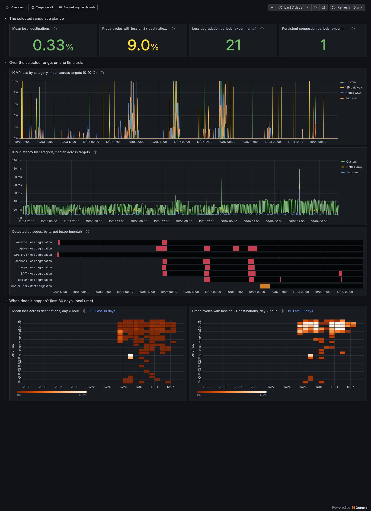
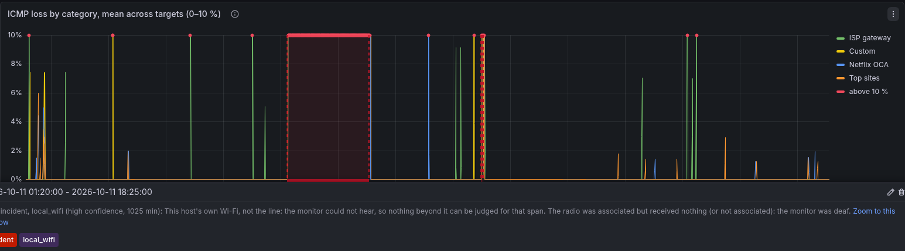
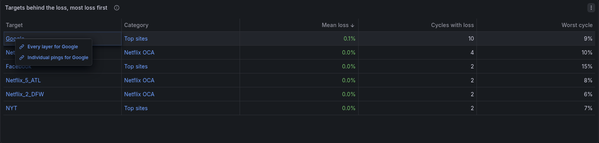

# Connectivity and quality

The **Connectivity & Quality** dashboard answers "is the connection's quality
changing, and when?". The Overview tells you how things are right now. This
dashboard puts the selected range (seven days by default) on one time axis,
so a burst of loss, a step in latency and a detected episode line up
vertically. Below that, it shows the last 30 days by hour of day, where a
daily pattern stands out.

Open it from the dashboard list (*SmokePing dashboards*) or from the
Overview's *Where to look next* list. It is part of the InfluxDB dashboard
set: Pro with ClickHouse does not have it.

## At a glance

| Tile | What it counts |
| --- | --- |
| Mean loss, destinations | Share of pings lost across every destination over the range |
| Probe cycles with loss on 2+ destinations | Share of 5-minute cycles in which at least two destinations lost packets at once |
| Loss degradation periods | Periods the inference module found on destinations that overlap the range, when it is on |
| Persistent congestion periods | Periods Jitterbug labeled congested on destinations that overlap the range, when it is on |

"Destinations" leaves out two kinds of target. The **ISP gateway**
rate-limits ICMP and has a loss floor of its own. The **DNS wizard's**
targets are left out because many CDNs drop ICMP. Both are ICMP targets
like the rest, but counting them would make the numbers describe the probes
rather than the connection.

The second tile is usually the more telling one. One destination losing
packets is that destination's problem. Two or more losing in the same cycle
point at something they share: the house, the line or the ISP. A cycle here
is a 5-minute window, the default probe step. With a different
[frequency](measurement-frequency.md), the share is still comparable from
one day to the next, but it is not a count of probe rounds.

## On one time axis

- **ICMP loss by category (0–10 %).** This is the Overview's loss panel
  zoomed to the range where everyday loss lives. A cut above 10 % runs off
  the top; a red dot on the top edge marks each window where a category
  did, and the tooltip still shows the real value (the Overview shows the
  full scale). Several categories rising
  together is the link; one alone is its destinations. Unlike the tiles,
  this chart keeps the ISP gateway's line: it sits on its own floor, and a
  band the gateway does not share is beyond the access link.
- **ICMP latency by category.** The median of the targets' medians, per kind
  of destination. The ISP gateway is left out: it answers ICMP from its
  control plane, whose spikes of hundreds of milliseconds would flatten
  every other line. The Overview's *Toward the ISP* panel charts it.
- **Detected episodes, by target (experimental).** What the
  [inference module](inference.md) found: red is loss degradation, orange is
  persistent congestion. Every target the module analyzes has a row, the
  ISP gateway included, so you can see whether the first hop moved too.
  These are detections, not confirmations. Compare them with the two panels
  above before believing one. The panel is empty unless the module is on
  (`sudo smoking-pi enable inference`).
- **Loss incidents (diagnosed).** The dark red markers along the bottom of
  the charts are the alerter's diagnosed incidents (see
  [alerting](alerting.md)), whatever they blamed: this host's Wi-Fi, the
  line, upstream, or the destinations. Hover one for the diagnosis in a
  sentence and its length; the link in it zooms this dashboard to the
  incident with a quarter of its length on either side. Toggle them off at
  the top of the dashboard when they get in the way. A probe missing a few
  pings is not shown.

  

## From an aggregate to a target

Every panel above speaks of categories; the ones below name the targets.
The rule is the same throughout the dashboards: **click a line to see its
category's targets, click a target to see every layer of it.**

- A **category line** in either chart opens the
  side-by-side dashboard (*Targets* folder) for that category over the same
  range, one panel per target: hover the line and click the link in the
  tooltip. The ISP gateway's line, in the loss chart, opens the gateway's cut
  dashboard instead, since it is a single target with a dashboard of its
  own; a DNS resolvers line opens the resolvers' side-by-side under *DNS*.
- **Targets behind the loss, most loss first** lists every destination that
  lost packets in the selected range: the share of its pings lost, the
  number of probe cycles in which it lost at least one, and its worst cycle.
  Several targets of one category at the top is that category's problem; the
  same share on every target, whatever its category, is the link. A target
  name opens Target Detail ([every layer of it](target-detail.md) on one
  page) or its individual pings; a category opens the side-by-side. As in the tiles, the ISP
  gateway and the DNS wizard's targets are left out.

  
- On the **side-by-side**, each panel's link icon and each series open
  Target Detail for that target, keeping the range.

The links keep the time range you are looking at, so the burst you clicked
on is still in view two dashboards later.

## When does it happen?

The two heatmaps cover the last 30 days, whatever the range picker says.
Each cell is one hour of one day in the dashboard's time zone (the browser's
unless Grafana is set otherwise):

- **Mean loss across destinations.** A single long cut lights a cell
  brightly. The color scale is compressed so that small everyday loss still
  shows.
- **Probe cycles with loss on 2+ destinations.** The share of that hour's
  cycles in which destinations lost packets together. A cut counts once per
  cycle, however deep it was. A recurring evening band here is loss the
  destinations share, every day at the same time.

A band in the heatmaps while the [ISP gateway](cpe-last-mile.md)'s loss
line stays flat is beyond the access link. A band that appears together
with Wi-Fi drops (see the [Wi-Fi dashboard](wifi.md)) is closer to home.
