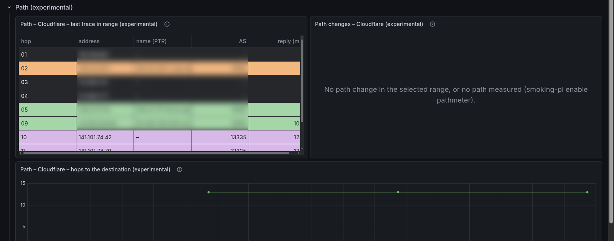
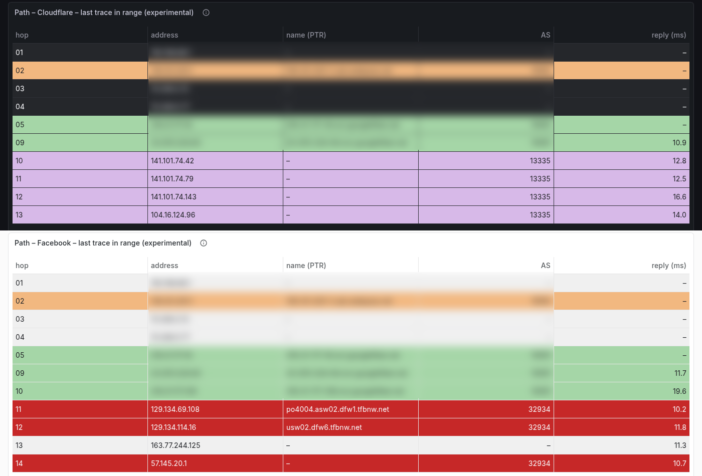

# The path to each destination (experimental)

!!! warning "Experimental"
    The path meter is off by default, is not in the alert path, and may
    change or go away without a deprecation period. Its results show on the
    Target Detail dashboard; nothing pages anyone.

The measurements say how long a destination takes to answer and whether it
answers. They do not say which way the packets went. The `pathmeter`
service traces the path to every measured destination once an hour, so a
latency step can be read next to the path it happened on, and a change of
route shows up as a change, not as a guess.

```bash
smoking-pi enable pathmeter
```

Pro with InfluxDB only. IPv4 only, like the rest of the Pi's measurements
when it has no global IPv6 ([IPv6 gating](ipv6-gating.md)).

## What it does

Every `PATHMETER_INTERVAL` seconds (default 3600):

1. **What to trace.** Every target measured in the last two hours, by its
   base name (`Google`, `Google_tcp443` and `Google_h2` are one destination,
   as on [Target Detail](target-detail.md)), from the host behind it. Names
   are resolved every cycle, since CDN names move, and names that resolve
   to the same address are traced once.
2. **How.** A Paris traceroute with [scamper](https://www.caida.org/catalog/software/scamper/),
   over ICMP: every probe to one destination keeps the same flow
   identifier, so a load balancer on the way keeps them on one path and the
   hops read as one path, not a mix of several. The identifier is the same
   every cycle too, so a destination stays on its path from one hour to the
   next unless the network moves it. One probe per hop, a second
   to wait for each, and the trace gives up after five silent hops in a row.
   Every probe of a cycle is paced together at `PATHMETER_PPS` per second
   (default 5), so no router on the way, shared or not, ever gets more
   than that from the Pi: about two minutes a cycle for 76 destinations.
3. **Never a burst at the router.** The first hops are the same for
   every destination: the home router, then the access network. A hundred
   traceroutes that each start at hop 1 would send a hundred probes at the
   router at once, and the same at every shared hop after it. So each cycle
   traces only **four destinations from hop 1**, in turn (the ones whose
   last full trace is the oldest), and every other destination from the
   first hop past the shared ones. The shared hops are learned from the
   latest full trace of every destination, so they move as soon as one of
   them shows the access path moved: a new gateway or a failover is
   followed in the cycle that sees it, and the destinations traced before
   it go first next. The router and each shared hop receive at most four
   probes a cycle (eight in the first cycles after the service starts or
   the access path moves),
   whatever the number of destinations; every destination is traced from
   hop 1 once every *destinations ÷ 4* cycles (19 hours for 76). Routers
   past the shared hops that many paths cross (a provider's edge) get one
   probe per destination crossing them, never faster than `PATHMETER_PPS`.
   Until the shared hops are known, the destinations not yet traced from
   hop 1 wait for their turn rather than all crossing them at once.

   One limit follows: a destination's own change inside the shared hops
   (it alone left them) is confirmed only by its next trace from hop 1.
4. **What changed.** A path counts as changed when a hop that answered
   both times answered from another address (or the destination got nearer
   or further), in **two traces in a row**: one trace that differs is a
   candidate the next confirms or drops, so a load balancer or a router
   answering once from another of its addresses is not a change. The AS
   path (the networks along the hops, see [Where the networks come
   from](#where-the-networks-come-from)) changing is flagged on its own, because it is usually the
   change that matters, and only once every hop's network is known, so a
   lookup still pending is not a change of network. A name with several
   addresses keeps the one it was traced at while DNS still returns it; one
   that resolved to a new address starts a new path, and that is not a path
   change.

## During a loss episode

The hourly traces describe a quiet hour. When every destination loses
packets at once (the reference house had such an episode most evenings
from late August to early October 2026), the question is *where*: inside
the access network every path shares, or beyond it. So while a shared
loss episode lasts, the path meter traces the destinations it hit every
five minutes.

- **What an episode is.** The alerter's widespread rule, as
  `get_loss_events` reports it: `WIDESPREAD_PCT` (80 %) of the targets
  reporting in a probe cycle had a loss event of at least
  `WIDESPREAD_LOSS_PCT` (30 %). The path meter has no detector of its own;
  it asks every five minutes for the last hour's widespread runs, and an
  episode is under way while its last lossy cycle is at most three steps
  old (the exporter writes a cycle a step after it ends, and a run carries
  across two missing ones). A run the rule reads as this host's own uplink
  down, or its own DNS, is not traced: nothing past a dead uplink answers,
  and a DNS failure is not on the path. The check itself is the last hour's
  loss-event queries every five minutes, a fraction of a second each.
- **What a round traces.** The destinations with a loss event in the
  episode first, then the others, each in turn (the one traced longest ago
  first), so a long episode covers all of them. One of each round's traces
  starts at hop 1, in turn: it shows the shared hops answering or not,
  hop by hop. The others start past them, as the hourly cycle's do. The
  home router gets at most twelve probes an hour more. No name is resolved
  during an episode: each destination is traced at the address its last
  hourly trace used.
- **The cap.** At most `PATHMETER_EPISODE_TRACES_PER_HOUR` traces (default
  60, five a round) in any sixty minutes, counted from a ledger in the
  service's state volume before each round is sent, so a restart or a
  crash mid-episode does not start a new hour. The affected destinations a round left out are counted as
  `capped`.
- **One loop.** Rounds and the hourly cycle run one after the other, never
  together, so `PATHMETER_PPS` holds over both; while a cycle runs (about
  two minutes) the rounds wait.

Round traces are tagged `trigger=episode` in InfluxDB (see below) with the
episode's start, so a panel can show them apart from the hourly ones or
leave them out. They are never part of the change tracking: a path seen
every five minutes while it loses packets is not two hourly traces in a
row. On Target Detail the **Last trace in range** of a range that ends
during an episode is its last round's.

Reading them: a round whose hop-1 trace goes silent inside the shared hops,
while the hops past them stop answering too, points at the access network;
the shared hops answering while the paths beyond them go silent at
different places points beyond it. A router's own replies are rate-limited
(see above), so one silent hop is not evidence: compare rounds.

### Why ICMP, and why Paris

Measured from the reference house on 2026-10-21, over its 76 destinations:

| Method | Reached the destination | Probes per trace (median) |
|---|---|---|
| ICMP Paris | 60 of 76 | 13 |
| UDP Paris | 34 of 76 | 14 |
| TCP to port 443 | 7 of 76 | 15 |

Plain `traceroute` and `mtr` change the flow identifier on every probe, so
behind a load balancer they draw a path that does not exist. Tracing every
equal-cost path (scamper's MDA) costs many times more probes and is not
done.

## Where it shows

On **Target Detail**, the collapsed **Path (experimental)** row:




- **Last trace in range**: hop, address, AS and reply time of the last
  trace in the selected time range. Pick an earlier range to see the path
  as it was then. Hops that did not answer are left out. The shared first
  hops of a destination traced past them show their addresses but no reply
  time: only one destination probed them that cycle.

  Each row takes its network's color, so a run of hops in one AS reads as
  one block and the hand-off from one network to the next stands out. The
  color comes from the AS number (the AS number modulo the twelve colors),
  so a network has the same color on every target and every refresh; two
  networks can still share one, so read the AS column when two blocks of
  one color touch. Hops with no AS, and private (RFC 1918), CGNAT
  (100.64.0.0/10), IPv4 loopback, link-local and ULA addresses, are gray;
  so is a router on an exchange point's LAN when no AS is known for it
  (its exchange column still names it).

  
- **Path changes**: when the AS path, the hops or the address changed in
  the range.
- **Hops to the destination**: how far the destination answered, per trace.

The **Path changed (experimental)** annotation marks confirmed changes on
every panel of the dashboard.

With the [inference module](inference.md#shared-path-segments-a-hypothesis-of-where)
on too, every loss period the whole connection shared gets a hypothesis of
where on the path a common cause would sit: the router, network or exchange
the destinations that lost cross and the others do not. Connectivity &
Quality lists it under *who lost*.

Every destination side by side (which networks they are in and share, which
networks answer at each hop, and how one destination's path moved next to
its RTT and loss) is the [Internet Topology](topology.md) dashboard.

A router's reply time is how fast its own slow path answers a probe that
expired there, and routers rate-limit those replies. It describes the hop;
it is not that hop's latency, and a slow or silent hop says nothing about
the traffic going through it. The reference house's own router answered
the first hop on only two traces in three.

## Where the networks come from

Each hop's network (its origin AS) is looked up locally with
[originet](https://github.com/estcarisimo/originet) (formerly map-ip-to-asn),
a Rust longest-prefix-match table over CAIDA's daily
[RouteViews prefix-to-AS](https://publicdata.caida.org/datasets/routing/routeviews-prefix2as/)
snapshot: about 4 MB compressed and 1.1 million IPv4 prefixes, checked for a
newer one once a day, cached in the service's state volume (the two newest
kept) and loaded in a few seconds. Every hop is answered at once by its
longest announced prefix: no query per address, nothing rate-limited, and
the first cycle already complete. A prefix announced by several networks
reports the first of them, as originet does.

A router can answer from an address on an **exchange point's LAN** (an
IXP): its port on the exchange. Then the hop is named by the exchange (the
**exchange (IXP)** column, with its city when known) and its network is the
**member** that uses that port, not whoever announces the LAN: on the
reference house, `206.223.118.40` is Transtelco's port (AS32098) on Equinix
Dallas, in a /23 AS18734 announces, and the hop after it is Transtelco's.
Both come from CAIDA's monthly
[IXP dataset](https://publicdata.caida.org/datasets/ixps/) (PeeringDB,
Packet Clearing House and Hurricane Electric merged: about 1,600 exchanges
and 80,000 IPv4 member addresses), checked weekly. An address the dataset
lists under two networks (sibling networks, route servers) is given
neither: its hop keeps the network that announces the exchange's prefix. A private hop (the home
router, the access network's 10.x routers) has no network, by design.

Each network's name (`HURRICANE - Hurricane Electric LLC, US`) comes from
CAIDA's monthly [AS Organizations](https://publicdata.caida.org/datasets/as-organizations/)
dataset, also checked weekly.

A download that fails keeps what is loaded, and a restart without network
loads the cached snapshot; a snapshot that looks broken (fewer than half a
million prefixes) is refused; a failed download is tried again an hour
later. The first start downloads about 17 MB (the routing snapshot, about
4 MB, then daily when CAIDA publishes one; the IXP dataset, about 8 MB, and
the AS names, about 5 MB, monthly) and takes about half a minute on a Pi's
half core; a restart afterwards, a couple of seconds.

Because the table answers by the exact announced prefix, takes the first
origin of a prefix several networks announce and the member for an
exchange port, a hop's network is the one the service labels show for the
same address: the exporter reads the same table.

All of it is downloaded by the Pi itself, for its own measurements, and
never shipped in an image or this repository; the data is CAIDA's
([RouteViews prefix-to-AS](https://www.caida.org/catalog/datasets/routeviews-prefix2as/),
[IXPs](https://www.caida.org/catalog/datasets/ixps/),
[AS Organizations](https://www.caida.org/catalog/datasets/as-organizations/)):
cite it if you publish results from it.

## Router names

Next to each hop the path table shows its **name (PTR)**: the reverse DNS
name the operator gave the address. It is often the best hint of where a
router is and what it does: `be1.core1.hou2.he.net` is a Hurricane Electric
core router in Houston, `192-200-234-53.mci.googlefiber.net` a Google Fiber
router in Kansas City, `ipv4-c366-atl001-ix.1.oca.nflxvideo.net` a Netflix
cache in Atlanta. It is also only a name: operators let them go stale, and
some do not set one. So a name is shown with its hop and never used to
judge a path: it is not part of the path, its hash or its changes, and a
router renamed is not a path change.

Public addresses only. Each address is asked once a week through the Pi's
resolver (one with no name again after a day, a failed query after an
hour), at most 100 new queries a cycle, eight at a time: the first day of
the reference house asked about 250, the days after almost none. On the
staging Pi, 43 of 66 routers had a name.

## What it costs

The routing data is about 4 MB a day of download when CAIDA publishes a
new snapshot, plus about 13 MB a month for the IXP dataset and the AS
names, not counted by `smoking-pi budget` (the netmeter counts it under
`pathmeter`).

At the defaults, about 600 probes an hour for the reference house's 76
destinations (about 3 % of the default samples ceiling) and a few MB a day.
Of those, the home router receives four an hour. For comparison, the CPE
microcut detector already sends the ISP's first hop 50 pings every 30
seconds.
`smoking-pi budget` shows the path meter as a `Traceroute` row with what
its cycles of the last day actually sent, on average, not an estimate,
and counts it in the totals
that [admission](measurement-budget.md#admission) checks a change against.

The episode rounds are reserved at their worst case, as an `EpisodeTraces`
row: the hourly cap times the probes a round trace costs (measured over
the last day's rounds, 13 until there are some). At the default, about 780
probes an hour (4 % of the default samples ceiling) and 2 MB a day, counted
whether an episode is under way or not, so admission keeps room for one. An
episode of three hours sends about a quarter of a megabyte.

Enabling it is not refused by admission: check `smoking-pi budget` first
on a connection that is close to a ceiling.

## Settings

| Setting | Default | |
|---|---|---|
| `PATHMETER_INTERVAL` | 3600 | Seconds between cycles; at least 600 |
| `PATHMETER_PPS` | 5 | Probes per second, every probe of a cycle together; at most 100 |
| `PATHMETER_EPISODE_TRACES_PER_HOUR` | 60 | Traces in any hour [during a loss episode](#during-a-loss-episode); 0 turns them off; at most 1200 |

`smoking-pi config set PATHMETER_INTERVAL 7200` changes one.

## In InfluxDB

Tagged `target` (the base name) and `category`, stamped at the cycle's
start:

- `path_trace`, one point per destination and cycle: `dst`, `hops`,
  `reached`, `path` (`addr|addr|*|…`, `*` a silent hop), `path_hash`,
  `as_path` (`64500 64501 15169`), `changed`, `as_changed`, `dst_changed`,
  `first_hop`.
- `path_hop`, one point per hop that answered, also tagged `ttl` (`01`,
  `02`…): `addr`, `ptr` (its reverse DNS name) when it has one, `asn`
  when known, `ixp` (the exchange point's name) when the address is on an
  exchange LAN, `rtt_ms`.
- `pathmeter_pass`, one point per cycle: `traces`, `probes`, `seconds`,
  `failed`, `prefix_hops`, `full_traces`.

The rounds traced [during a loss episode](#during-a-loss-episode) write the
same three measurements, every point tagged `trigger=episode` (the hourly
ones have no `trigger` tag), plus `episode` (the episode's start, an ISO
time) on `path_trace` and `capped` on `pathmeter_pass`. To leave them out
of a query: `filter(fn: (r) => not exists r.trigger)`.

Addresses are fields, not tags, so routers do not multiply series.

## Privileges

The container runs on the host network (the hops are the house's, not a
Docker bridge's plus one) with every capability dropped but four:
`NET_RAW` for the probes, and `SYS_CHROOT`, `SETUID` and `SETGID` for
scamper's own privilege separation, which runs the part that parses what
the network sends back as `nobody`, chrooted in an empty directory.

## Not yet

- A limit per network, so a large set of discovered targets does not
  concentrate probes on one operator ([measurement budget](measurement-budget.md),
  *What comes next*).
