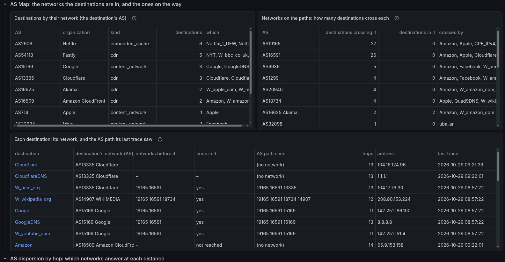
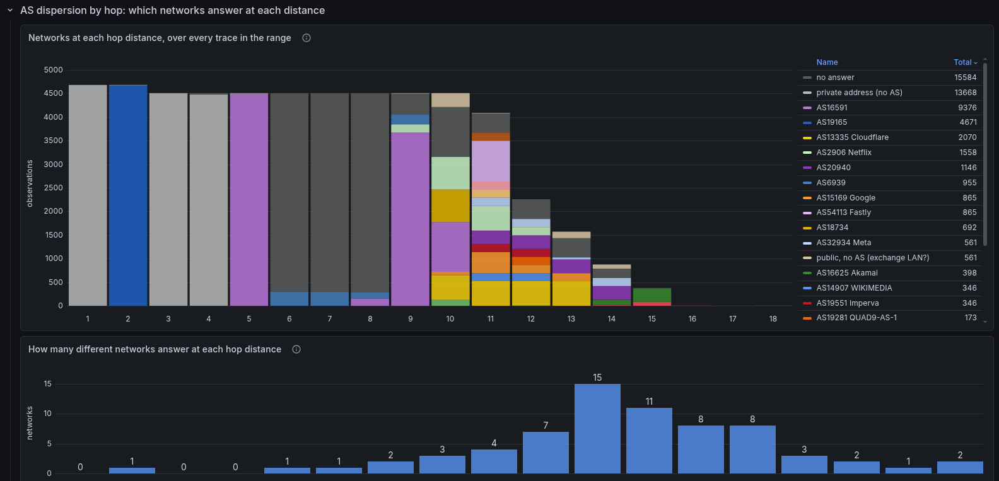
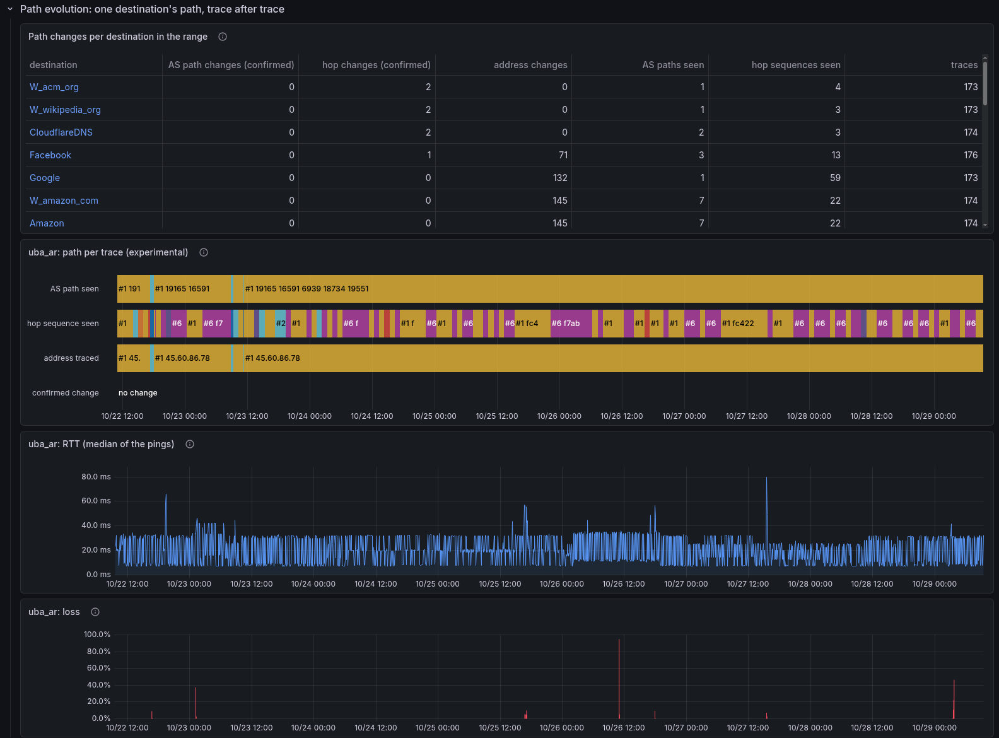

# Internet Topology (experimental)

!!! warning "Experimental"
    A view over what the [path meter](path.md) already records: no new
    probes, nothing in the alert path, and it may change or go away without
    a deprecation period. Pro with InfluxDB, and only with the path meter
    on (`smoking-pi enable pathmeter`).

The measurements say how fast each destination answers. The path meter says
which way the packets went to each one, an hour at a time. This dashboard
puts the destinations side by side to answer two questions a home user can
act on: **how does this house reach the Internet**, and **which networks do
the destinations it measures have in common**. It is not a network
operations tool: a route that changes is a fact to read, not something to
be paged about.

Open **Internet Topology (experimental)** in the Grafana folder *Advanced*,
or from the *SmokePing dashboards* dropdown. Its default range is the last
7 days; routes change over days, not minutes.

Only the hourly traces count. The extra traces the path meter takes [during
a loss episode](path.md#during-a-loss-episode) (tagged `trigger=episode`)
are left out, so an evening of loss does not weigh more than any other
hour, and every destination contributes one trace per cycle.

## Filters

- **Destinations**: the destinations the path meter traced in the range, by
  base name (`Google`, not `Google_h2`). All by default.
- **AS**: keep only the destinations whose recorded path crossed this
  network (autonomous system, by number) at any hop in the range.
- **Path evolution of**: the one destination the last row follows. A click
  on a destination in the tables above picks it.
- The time range: every panel reads the range picked.

## AS Map

- **Destinations by their network**: every destination measured in the
  range, grouped by the network its host's address is in (from the same
  labels as [Targets by service](targets-by-service.md)). Destinations in
  one row share a network: on the reference house, six Netflix names are
  all Netflix's own network (embedded caches), five sites are all served by
  Fastly.
- **Networks on the paths**: every network a trace crossed, named (see
  [what it cannot say](#what-it-cannot-say)), with how many
  destinations' paths cross it **on the way** and how many are **in it**.
  The house's provider is first (every path crosses it); the transit
  networks after it are the infrastructure some destinations share and
  others do not.
- **Each destination**: its own network next to the AS path its last trace
  saw, with the destination's network taken off the end (*networks before
  it*). *Ends in it* says whether the trace's last answering network is the
  destination's: `no` is a CDN address announced by the network that hosts
  it, an exchange point, or two lookups disagreeing; `not reached` a
  destination that did not answer the trace.

The destination's network and the networks on the way are kept in separate
columns on purpose: the first says who answers, the second who carries the
traffic there, and they are different questions.

## AS dispersion by hop

Each bar is one distance from the house (hop 1 is the home router), and its
segments count how many times, over every trace in the range, that hop
answered from each network. It is the spread of many observations, not one
traceroute. Read it from the left:

- one color filling a bar is a stretch every path shares (the home router,
  the provider);
- several colors stacked are where the paths part, toward different transit
  networks and, at the end, the destinations' own;
- **no answer** (dark gray) is a hop inside a trace's length that did not
  reply: many routers do not answer traceroute, or rate-limit it. On the
  reference house, hops 6 to 8 almost never answer;
- **private address** (light gray) is a hop that answered from an address
  no network announces (the home router, the provider's internal `10.x`
  routers);
- **public, no AS** (beige) answered from a public address no network
  announces, most often an exchange point's LAN.

Bars get shorter to the right as destinations are reached. The second chart
counts how many different networks answered at each distance: one is a
shared stretch, more is where the destinations' paths part.

A destination traced past the shared first hops (see [the path
meter](path.md#what-it-does)) counts those hops with the addresses its
latest full trace learned, so every destination contributes one observation
per hop per cycle.

## Path evolution

- **Path changes per destination**: the *confirmed* columns count only what
  two traces in a row agreed on (as the path meter decides a change). *AS
  paths seen* and *hop sequences seen* count what single traces saw,
  confirmed or not: more sequences than confirmed changes is usually a
  load balancer, or a router answering from another of its addresses, not a
  new route. A destination behind a name that resolves to many addresses
  (Google, Amazon) changes address almost every hour; that is DNS, not the
  route.
- **Path per trace**: one bar per trace for the destination picked. The AS
  path, the hop sequence (a short hash of the hop addresses) and the address
  traced are numbered in the order they first appeared (`#1`, `#2`…), each
  keeping its color; the last row marks only the confirmed changes.
- **RTT** and **loss** of the same destination's ICMP probe, on the same time
  axis, with the *Path changed (experimental)* annotation. A latency step
  that lines up with a confirmed change is worth reading together; one that
  does not happened on a path the traces did not see change.

## What it cannot say

- **A hop's network is an inference.** It is the network that announces
  the address's prefix in BGP (CAIDA's RouteViews table), or the member
  that uses an exchange point's port ([where the networks come
  from](path.md#where-the-networks-come-from)). A router can answer from an
  address another network owns (its interface on a link numbered by its
  neighbor), and a tunnel (MPLS) can hide hops entirely. Neither the AS
  path nor the counts are proof of which networks forwarded the traffic.
- **One vantage point, one direction.** The traces go from this house to
  each destination, one flow each (Paris traceroute over ICMP). The way
  back, the other equal-cost paths a load balancer spreads traffic over,
  and the networks these traces never cross are not seen. The dashboard
  shows the house's view of the Internet, not the Internet's topology.
- **Who networks are, not how they relate.** Two destinations behind the
  same transit network share that network; nothing here says anything
  about the business relationships between networks.
- **A network's name is a registry's.** A network that is some
  destination's own shows its operator from the targets' labels (`Google`);
  any other shows the organization CAIDA's AS2Org file gives for its number
  (`AS6939 Hurricane Electric LLC`), as the path meter recorded it with the
  hop. Hops traced before the path meter recorded names (v2.49.0 and
  earlier) show the number alone. An organization's registered name is not
  always the brand people know.
- **A silent hop is the router's choice.** A hop that does not answer, or
  answers slowly, says nothing about the traffic going through it.

## In InfluxDB

The dashboard writes nothing. It reads `path_trace` and `path_hop` from the
path meter ([In InfluxDB](path.md#in-influxdb)), including each hop's
`as_name`, and `target_labels` from the exporter ([service
taxonomy](taxonomy.md)).
