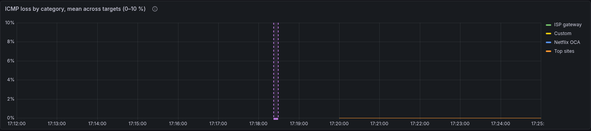

# Upgrading the stateful images

Most base-image bumps here are safe and Dependabot can be trusted with them:
a new `python:3.14-slim` or `grafana-oss` patch changes what runs, not what is
stored, and a green CI build is real evidence.

Two images are different, because they own volumes: **postgres** and
**influxdb**. For those, a major bump is a data migration wearing a version
string (and for InfluxDB a minor can be one too: 2.9 hashed every stored
token on first start, one-way), and **CI cannot validate it** — the Docker build matrix does not build
the postgres image at all, and no CI job has an existing volume to start
against. A green check on such a PR means nothing was tested. Dependabot is
configured to leave these alone (`.github/dependabot.yml`); do them by hand,
deliberately, using the procedures below.

## With the command

`smoking-pi backup` does the dump and the volume tarballs below in one go
(with the stack stopped for a minute), `smoking-pi restore DIR` puts them
back (on a new card with only the package installed, it restores the edition
the backup was taken from and records it), and `smoking-pi upgrade` pulls or rebuilds, recreates what changed
and runs the doctor — [Packaging](packaging.md#the-command). The procedures
below are what those commands do, for when you need one step of them.

`upgrade` also brings an installed OpenClaw skill up to the new release.
The skill is the answering guide, which changes in most releases, and an
old copy fails silently: the assistant keeps answering in the previous
release's shape. When `~/.openclaw/skills/smokeping-monitoring/SKILL.md`
exists for the user who ran `sudo` (or for you, from a clone) and differs
from the release's, `upgrade` replaces it, reloads the gateway and says to
start a new chat session. The copy it replaced is kept as `SKILL.md.bak`,
which matters if you tuned the skill in place (its `description:`): apply
that to the new one, because the next refresh overwrites the `.bak`.
A skill that was never installed stays that way, and a current one is left
alone, so the gateway is not restarted for nothing. If the refresh fails,
`upgrade` still succeeds and prints the command that does it:

```bash
sudo smoking-pi openclaw
```

`upgrade` also removes the images of the releases this host no longer
runs. Every upgrade pulls (or builds) a new set of thirteen images, and
until this change every previous set stayed on disk: on 2026-10-16 the
reference Pi's upgrade pulled onto a card that already held every release's
images since 2.13.8 (513 images, 92 GB of 117), and the card filled.
PostgreSQL crash-looped on `postmaster.pid`, Grafana's SQLite reported the
disk full, and InfluxDB refused every WAL write until its container was
restarted, even after space was freed, sixteen minutes of measurements
lost. Now, once the new release's containers are all running, and still
running ten seconds later, `upgrade`
removes each `ghcr.io/estcarisimo/smoking-pi/*` image whose tag is not the
version it just brought up, one `docker image rm` at a time, and says how
many it removed and up to how much space (their sizes added; layers the
new images share stay). It never runs `docker image
prune`, which would take cloudflared and whatever else the daemon holds;
it never removes an image a container (running or stopped) still
references; and while any container of the stack is not running at
either look it removes nothing, so a failed upgrade keeps the previous release's images
to go back to. The doctor's `disk-free` check (`smoking-pi doctor --live`)
warns when the filesystem under Docker's data root is under 10 % or 5 GB
free (fails under 2 % or 1 GB), and names old image tags when it sees them.

### The upgrade's window in the measurements

Recreating the containers takes the Pi's own measurements down with it for
a minute or two, and that showed up in the data as a cut on every
destination at once, the ISP gateway included: 4–6 % loss everywhere on
the reference Pi's 2026-10-15 upgrade, 66 % on 2026-10-18. Nothing said
an upgrade had happened, so it read as network trouble. `upgrade` now
writes its own start and end into the edition's InfluxDB bucket
(`smokeping`), measurement `upgrade`:

| | When | Tags | Field |
| --- | --- | --- | --- |
| start | after the pull (or build), before the first container changes | `phase=start`, `from_version`, `to_version` | `value=1` (float) |
| end | once InfluxDB takes writes again after `up` | `phase=end`, `from_version`, `to_version`, `result=ok` | `value=1` |
| end | when the upgrade fails or is interrupted after the start | `phase=end`, …, `result=failed` | `value=1` |

`from_version` is the tag of the image InfluxDB ran before (`dev` for a
clone's own build), `to_version` the release being brought up. A pull that
fails touched no container and records nothing. The end point is stamped
when the stack is back and retried for up to a minute (by the clock)
while a recreated InfluxDB starts. Recording never stops an upgrade: when InfluxDB does not
take a point, `upgrade` says so in one line and goes on, and that window
has no start or no end.

The *Upgrades* annotation on **Overview** and **Connectivity & Quality**
shades each window, labeled `Upgrade 2.43.0 → 2.44.0 (95 s)` (`, failed`
when it was). The inference module reads the same points
and leaves each window out of its shared passes.



Hover the region for its label. An in-progress upgrade (a start with no end
yet) is not drawn until its end arrives.

Only Pro with InfluxDB records them. Basic and Standard have no time-series
database, and the ClickHouse backend has no table for events like this one
(the exporter writes only `latency`), so there `upgrade` records nothing and
says nothing about it.

One command changes the containers at a time. A second `upgrade`, `up` or
`config set` started meanwhile says *Another smoking-pi command is changing
this stack; waiting for it to finish* and runs after it. Two Compose runs
recreating the same containers at once fail with `Conflict. The container
name "/<id>_pro-influxdb-1" is already in use`, or leave containers running
under that temporary `<id>_` name. A `docker compose up` typed by hand is
not under the lock, so after every `up` the command renames such a
container back, removes a copy that never started, and, if `up` failed
while one was in flight, waits for the other run and tries once more.

## PostgreSQL

PostgreSQL is this project's **config source of truth** — the YAML files are
import/export only. Losing the volume means losing every target definition.

Two independent things break on a major bump, and the second is worse:

1. **The data directory is version-locked.** Pointed at a PG15 directory, PG18
   exits immediately:

   ```
   FATAL:  database files are incompatible with server
   DETAIL: The data directory was initialized by PostgreSQL version 15,
           which is not compatible with this version 18.6.
   ```

   Loud, and safe — nothing is damaged.

2. **PG18 moved its default `PGDATA`**, from `/var/lib/postgresql/data` to
   `/var/lib/postgresql/18/docker`. Our compose mounts the volume at the old
   path, so the entrypoint does not find a cluster where it now looks, reports
   *"Database is uninitialized"*, and — given a password — would **initialize a
   brand new empty cluster**, leaving the real data orphaned in the volume.

   This one **fails open**: the container comes up healthy, config-manager
   bootstraps into an empty database, and the symptom is every target quietly
   disappearing rather than an error. Assume this mode, not the first.

### Procedure

Dump before touching anything. The dump is the rollback.

```bash
cd editions/pro
docker compose exec postgres pg_dumpall -U "$POSTGRES_USER" \
  > ~/pg-backup-$(date +%F).sql
```

Then either restore into a fresh volume of the new major:

```bash
docker compose down postgres
docker volume rm pro_postgres-data          # only after the dump is verified
# bump the FROM in shared/modules/postgres/Dockerfile, then:
docker compose build postgres && docker compose up -d postgres
docker compose exec -T postgres psql -U "$POSTGRES_USER" < ~/pg-backup-YYYY-MM-DD.sql
```

or run `pg_upgrade` with both binaries present. The dump/restore path is
slower and much harder to get wrong; this database is small.

Afterwards, confirm the data actually arrived — a healthy container proves
nothing here:

```bash
curl -s -H "Authorization: Bearer $CONFIG_API_TOKEN" \
  http://127.0.0.1:5000/targets | jq '.total'
```

If `PGDATA` moved again, also update the volume's mount point in
`editions/*/docker-compose.yml` to match the new default rather than relying
on it.

## Grafana

Grafana migrates its own database on first boot of a new version, and
**there is no downgrade**. Once 13.x has migrated `grafana-data`, going back
to 12.x needs a volume restore.

It is otherwise low-risk: 13.0.2 boots clean on this stack (verified against a
fresh volume — healthy, migrations completed, no plugin errors with
`GF_INSTALL_PLUGINS` empty). The dashboards are provisioned from files, so
they are not at risk; only Grafana's own state is.

```bash
docker run --rm -v pro_grafana-data:/from -v "$PWD":/to alpine \
  tar czf /to/grafana-data-$(date +%F).tgz -C /from .
```

Then bump `shared/modules/grafana/Dockerfile`, rebuild, and check
`docker compose logs grafana` for `migrations completed` before assuming it
worked.

## Pulling past v2.11

Since the relocatable-state change (after v2.11.0, `docs/packaging.md`),
`editions/<edition>/config-manager/{config,output}` are no longer tracked.
The commit that untracked them *deletes* them from any working tree that
still has them tracked — so on a host running the stack, `git pull` past
that commit removes `targets.yaml`, `probes.yaml`, `sources.yaml`, `Targets`
and `Probes` from the host directories the containers have mounted. This
happened on the reference Pi.

Nothing is lost: PostgreSQL is the source of truth and SmokePing keeps its
loaded configuration until it is told to reload. Rebuild and recreate
config-manager (the same commit changed its image, and a plain `up -d`
does nothing when neither the image nor the resolved service config
changed):

```bash
cd editions/pro && docker compose build config-manager && docker compose up -d config-manager
```

On start it re-seeds the three YAML files from its `templates/` (the
mechanism that has always recovered a missing file), runs the idempotent
migration (marker present: only a probe or category the database has never
seen would be added — none, on a current deployment) and regenerates
`Targets` and `Probes` from the database. The startup path writes the
files but does **not** signal SmokePing; that only happens on an API-driven
change. It does not matter here — the regenerated files equal what
SmokePing already has loaded — unless the database changed in between, in
which case reload it:

```bash
docker compose exec smokeping killall -HUP smokeping
```

Check with `python -m doctor --repo-root . --live`. Any local edits that
lived only in the YAML (not in the database) are gone; the YAML is
import/export, and the database has had every target since Sprint 3
(v2.1.0).

From then on the directories are ignored by git and `git pull` leaves them
alone.

## Pulling past the published-images change

After [Published images](packaging.md#published-images) (after v2.11.0),
every built service names its image `ghcr.io/estcarisimo/smoking-pi/<service>:dev`
instead of `pro-<service>`. On a development host the next
`docker compose up -d` therefore recreates every container and, unless the
old images are re-tagged first, rebuilds all nine — the loop in that
section keeps the existing images. Either way the stack restarts once;
nothing in the volumes changes.

## Verifying any upgrade

`doctor --live` is the check that the thing you built is the thing that is
running — it compares the sha256 of every deployed `.py` against the
repository, which is how a masked build failure gets caught rather than
silently serving a three-week-old image:

```bash
PYTHONPATH=shared/modules/doctor python -m doctor --repo-root . --live
```

## Uninstalling

From a package, two levels, and neither touches the measurements:

- `sudo apt remove smoking-pi` stops the unit and removes the code
  (`/opt/smoking-pi`) and the command. Everything else stays: the Docker
  volumes, `/etc/smoking-pi` (env file, config), `/var/lib/smoking-pi`, the
  conffile. Reinstalling the package puts you back where you were.
- `sudo apt purge smoking-pi` also removes the conffile
  (`/etc/default/smoking-pi`) and the two directories the stack
  regenerates on the next start (`/etc/smoking-pi/config`,
  `/var/lib/smoking-pi/output`). It keeps the Docker volumes **and**
  `/etc/smoking-pi/env`, and says so: the env file holds the credentials
  the volumes are locked with, so removing it alone would not free space,
  it would make a year of data unreadable.

To delete the measurements, decide it explicitly, with the command still
installed: `sudo smoking-pi purge` (the volumes, after typing the project
name) or `sudo smoking-pi purge --config` (the env file and directories
too), then `apt purge`. From a clone the same commands apply, without
`sudo` (`smoking-pi purge`), and there is nothing to `apt remove`.

